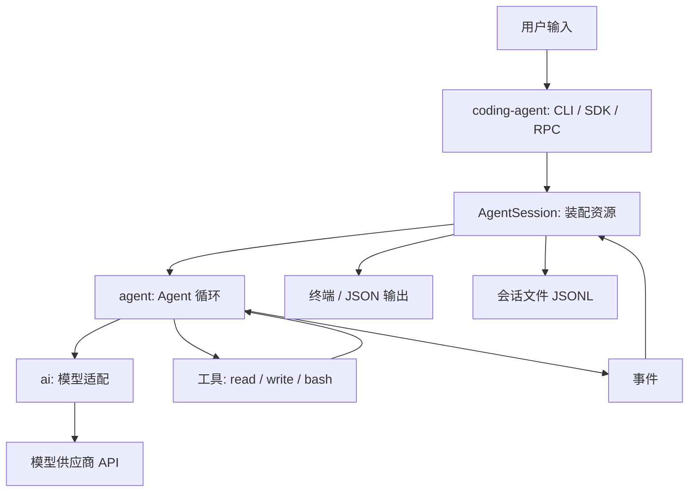

# 01. 仓库地图与运行环境

> 预计时间：2.5 小时（主线阅读加 8 个只读实验；源码细节见选读）
> 先修：TypeScript 核心（`task-00-typescript-core.md`）。需要知道两件事：类型在运行时会被删除；`await` 会等待 Promise 完成。

## 本篇你会学到

- 说出 `packages/` 下 14 个目录各自的职责，并知道之后哪一篇深入讲它。
- 在仓库根目录从源码启动 pi，并确认启动的是工作区源码，而不是安装版。
- 沿 `main` → `AgentSession` → `Agent` → `pi-ai` 的调用链，指出一次模型请求经过哪几个包。

## 先用一个例子理解

在 `D:\my-project` 目录下运行 pi，输入：

```text
读取 demo.txt，并总结三点。
```

模型不能直接读你电脑上的文件。它只能收到文字，并返回文字。如果没有中间程序，模型只能凭空猜文件内容。

所以需要一个程序替模型完成四件事：

1. 把你的话、历史消息和"可用工具列表"一起发给模型。
2. 模型回复"请调用 `read` 工具，参数是 `demo.txt`"。模型只是提出请求，没有读文件。
3. 程序在本地执行 `read`，把文件内容作为新消息交给模型。
4. 模型看到文件内容后，写出三点总结。

pi 就是这个程序。仓库把它拆成几层，每层一个包：

| 层 | 包 | 在这个例子里做什么 |
| --- | --- | --- |
| 应用 | `packages/coding-agent` | 接收命令、选择运行模式、装配会话、提供 `read` 工具 |
| 运行时 | `packages/agent` | 决定何时请模型、何时执行工具、何时结束 |
| 模型适配 | `packages/ai` | 把不同供应商的接口统一成同一套消息和事件 |
| 终端 | `packages/tui` | 画界面、接收按键、显示增量文字 |



一句话概括：输入从入口进来，应用层装配好会话，Agent 循环反复与模型和工具打交道。过程中的事件回到界面，记录写入磁盘。

### 把这一次请求拆成五个时刻

下表是示意，不是真实日志。它只说明每一步谁在说话、本地发生了什么。

| 时刻 | 谁说话 | 内容（示意） | 本地发生了什么 |
| --- | --- | --- | --- |
| 1 | pi 发给模型 | 系统说明、可用工具列表（含 `read`）、用户消息"读取 demo.txt，并总结三点" | 无 |
| 2 | 模型回复 | 一个工具调用请求：工具名 `read`，参数 `demo.txt` | 无，模型没有读文件 |
| 3 | pi 在本机执行 | 调用 `read` 工具的执行函数，读取磁盘上的文件 | 文件内容进入内存 |
| 4 | pi 发给模型 | 把文件内容作为"工具结果"追加到消息列表，再发一次请求 | 无 |
| 5 | 模型回复 | 最终文字回答（三点总结），没有新的工具调用 | 本次运行结束 |

读这张表时注意两点。

- 第 2 步的回复不是最终答案，而是一个请求。模型之所以只能提请求，是因为它运行在远程服务上，碰不到你的磁盘。
- 第 5 步之所以结束，是因为模型没有再请求工具。第 2 步到第 4 步的来回，就是 Agent 循环。循环的判断细节见 `task-05-agent-loop.md`，本篇只需要知道它存在。

如果没有 `read` 这样的工具，模型只能编一段看起来合理的总结。你无法从文字本身判断它是否在编造。

## 核心概念

**monorepo（单仓库多包）**：一个 git 仓库里放多个可以独立发布的包。每个包有自己的 `package.json`（包名、版本、依赖）。根目录的 `package.json` 用 `workspaces` 字段把它们列在一起。

为什么需要：`coding-agent` 要用 `agent` 的最新代码，而两者经常一起修改。放在一个仓库里，一次提交就能同时包含两边的改动。不必先把 `agent` 发布到 npm，再回头更新 `coding-agent` 的依赖。

例：`packages/coding-agent/src/core/sdk.ts` 里写了 `from "@earendil-works/pi-agent-core"`。在本仓库中，这个包名通过 `node_modules` 里的链接指向 `packages/agent`。实验 6 会亲手看到这个链接。

**agent harness（智能体运行框架）**：承载"模型 + 工具 + 状态 + 界面"的程序。框架本身不做决定，它负责把各部分按顺序接起来。pi 就是一个 harness。

为什么需要：没有框架时，每个程序都要自己写一遍同样的流程：发请求、解析回复、判断是否要调用工具、执行工具、把结果拼回消息、再发请求。pi 把这套流程写一次，放在 `agent` 包里。`coding-agent` 只负责配置它用哪个模型、哪些工具。

**依赖方向**：包之间只能单向引用。`coding-agent` 依赖 `agent`，`agent` 依赖 `ai`，反过来不行。

为什么需要：下层不认识上层的具体用法，才能被别的程序复用。假设 `agent` 反过来 import 了 `coding-agent`，就形成了环：`coding-agent → agent → coding-agent`。加载顺序变得难以判断，两个包都无法单独使用。

例：`packages/tui/package.json` 没有任何 pi 包依赖，所以别的 Node 项目也能单独使用它。

**三种运行形态**：同一份代码有三种启动方式。它们读的代码不同，改动是否生效也不同。

| 形态 | 启动方式 | 读的代码 | 改了 `src/` 后是否生效 |
| --- | --- | --- | --- |
| 安装版 | `pi` | `dist/bundle/cli.js`（实验 5 会读到这个入口） | 不会。`dist/` 是构建产物，需要重新构建 |
| 源码运行 | `.\pi-test.ps1` 或 `./pi-test.sh` | `src/cli.ts` 或 `src/experimental/cli.ts` | 会 |
| 测试环境 | `./test.sh` | 源码，但用户目录和临时目录指向隔离位置 | 会，且不改动你的 `~/.pi` |

例：你改了 `src/` 却没看到效果，通常是在运行安装版。

**source-resolver（源码解析器）**：源码运行时加载的一个 Node 钩子文件，路径是 `packages/coding-agent/src/experimental/source-resolver.ts`。钩子指 Node 在加载模块前调用的一段代码，它可以改写导入的目标。

为什么需要：源码里的导入写的是包名，例如 `@earendil-works/pi-ai`。Node 默认按 `node_modules` 找包，它不读根目录 `tsconfig.json` 里的路径映射。如果不处理，源码运行时可能悄悄加载过期的 `dist/`。`source-resolver` 让这些导入改走 `src/`。具体规则见选读 2。

**AppMode（运行模式）**：`main()` 根据命令行和终端连接情况选出的运行形态，取值为 `interactive`、`print`、`json`、`rpc` 之一。例：`pi -p "总结 README"` 得到 `print`，不会进入全屏界面。

为什么需要：同一套 Agent 要服务三类使用者：键盘前的人、脚本、其他程序。每类使用者需要不同的输入输出外壳。`AppMode` 把"选哪个外壳"集中到 `resolveAppMode` 一个函数里决定，下一节会逐行讲它。

TTY（终端设备）是判断"是否连着真正终端"的依据。Node 用 `process.stdin.isTTY` 判断标准输入，用 `process.stdout.isTTY` 判断标准输出。管道（`|`）和重定向（`>`）会让对应的值变成假值，表示不是终端。

## 源码导览

### 仓库地图：14 个 packages 目录

下表的 npm 名和描述来自各目录的 `package.json`，已用 `node` 读取核对。

| 目录 | npm 名 | 一句话职责 | 深入讲解位置 |
| --- | --- | --- | --- |
| `agent` | `@earendil-works/pi-agent-core` | 通用 Agent 运行时：消息状态、工具调用循环、事件 | `task-05-agent-loop.md` 为主；另见 `task-02`、`task-03`、`task-06` |
| `ai` | `@earendil-works/pi-ai` | 统一的多供应商 LLM 接口，同一套消息与流式事件 | `task-04-providers.md` 为主；另见 `task-05`、`task-12` |
| `chord` | `@earendil-works/chord` | 应用组合运行时：服务、复制状态、RPC、插件 | `task-15-advanced-systems.md` |
| `client` | `@earendil-works/pi-client` | 远程 pi 会话的传输无关客户端，使用 CBOR 帧 | `task-15-advanced-systems.md` |
| `codemode` | `@earendil-works/pi-codemode` | 沙箱 JavaScript 执行，唯一能力是调用注入的工具 | `task-15-advanced-systems.md` |
| `coding-agent` | `@earendil-works/pi-coding-agent` | 用户使用的 `pi` 命令：会话、资源、工具、扩展、各运行模式 | 从 `task-02-request-journey.md` 到 `task-14-testing-debugging.md` |
| `durable` | `@earendil-works/pi-durable` | 持久化的会话、任务和文档运行时 | `task-15-advanced-systems.md` |
| `evals` | `@earendil-works/pi-evals`（私有包，没有 description） | 行为评测：用 vitest-evals 对编码代理做对照实验 | `task-15-advanced-systems.md` |
| `mcp` | `@earendil-works/pi-mcp` | 独立的 Model Context Protocol 客户端，接入外部工具 | `task-15-advanced-systems.md` |
| `protocol` | `@earendil-works/pi-protocol` | 远程会话的 CBOR 协议帧与消息类型 | `task-15-advanced-systems.md` |
| `server` | `@earendil-works/pi-server` | 实验性服务端 | `task-15-advanced-systems.md` |
| `session-backends` | 无（没有 `package.json`，不是 npm 包） | 会话存储后端目录。当前检出中只有 `sqlite-node/dist/`，它被 `.gitignore` 忽略，git 不跟踪任何文件 | `task-15-advanced-systems.md` |
| `telemetry` | `@earendil-works/pi-telemetry` | 厂商中立的遥测契约与类型化 schema | `task-15-advanced-systems.md` |
| `tui` | `@earendil-works/pi-tui` | 终端 UI 库，使用差分渲染（只重绘变化的部分） | `task-13-terminal-ui.md` |

### 14 个目录的阅读指南

每个目录列出先打开的文件，路径都相对仓库根。这些文件本地都已确认存在。第一次读时，只看每个文件的导出名（`export` 开头的行），不要逐行读完。

- **`agent/`**：先开 `packages/agent/src/agent.ts`，找 `Agent` 类和它的 `prompt` 方法。再开 `packages/agent/src/agent-loop.ts`，看 `runAgentLoop` 和内部的 `runLoop`。`types.ts` 放事件和消息类型，读循环时对照事件名。
- **`ai/`**：先开 `packages/ai/src/index.ts`，它是对外的导出清单。再开 `packages/ai/src/compat.ts`，看 `streamSimple`。`providers/faux.ts` 是假模型，学习和测试都用它，不需要 API key。具体供应商的协议实现在 `packages/ai/src/api/` 下。
- **`tui/`**：先开 `packages/tui/src/tui.ts`，它的 `export` 行列出了鼠标事件等类型。`terminal.ts` 导出 `refreshTerminalDimensions` 等终端相关函数。`components/` 下是编辑器、列表、Markdown 渲染等组件。第一次读只看组件文件名。
- **`coding-agent/`**：这是最大的包。先开 `packages/coding-agent/src/main.ts`（`main` 和 `resolveAppMode`），再开 `src/cli/args.ts`（`parseArgs`）。然后读 `src/core/sdk.ts`（`createAgentSession`）和 `src/core/agent-session.ts`（`AgentSession`）。`src/core/` 下的会话（`session-manager.ts`）、设置（`settings-manager.ts`）、工具（`tools/`）、压缩（`compaction/`）等，按对应篇再读。`docs/cli.md`、`docs/sdk.md`、`docs/rpc.md` 是包内的用户文档，可以和源码对照。
- **`chord/`**：先开 `packages/chord/src/api.ts`，它导出 `createFacetHost`、`defineFacet` 等入口函数。`src/types.ts` 放公共类型。`README.md` 和 `PLANNING.md` 是包自带的说明。
- **`client/`**：先开 `packages/client/src/client.ts`（`Client` 类），再看 `src/transport.ts` 里的 `ByteTransport` 接口。它说明客户端只需要"能收发字节"的传输层。`src/unix.ts` 是 Unix socket 传输，Windows 上不可用，见选读 7。
- **`codemode/`**：先开 `packages/codemode/src/index.ts`，它导出 `CodemodeSandbox`。`src/runtime/` 是沙箱执行的实现。`src/declarations.ts` 描述注入给代码的工具签名。
- **`durable/`**：先开 `packages/durable/src/index.ts`，它导出 `defineDoc` 和 `ConversationBusy` 等。`src/session/`、`src/harness/`、`src/storage/` 分别对应会话、运行框架和存储。`docs/spec.md` 是包的规范文档。
- **`evals/`**：先读 `packages/evals/README.md`，再开 `src/harness.ts`（`PiCodingAgentHarnessOptions` 等类型）。`src/plan.ts` 和 `src/report.ts` 分别处理评测计划和报告，`src/cli.ts` 是命令行入口。`evals/` 子目录放具体的评测用例。
- **`mcp/`**：先开 `packages/mcp/src/client.ts`（`McpClient` 类）。`src/transports/` 放不同的连接方式，`src/oauth/` 放认证代码。读的时候把 MCP 的工具列表和 pi 自己的工具系统对照。
- **`protocol/`**：先开 `packages/protocol/src/framing.ts`，它有 `encodeFrame` 和 `FrameError`，讲字节如何分帧。再开 `src/codec.ts`（`encodeClientMessage`、`parseServerMessage`），讲消息如何编码和校验。`src/protocol.ts` 里的 `PROTOCOL_VERSION` 当前为 `8`。
- **`server/`**：先开 `packages/server/src/server.ts`（`Server` 类），再看 `src/session-router.ts`（`SessionRouter`），它决定一条连接交给哪个会话。`src/transports/` 放服务端的连接方式。
- **`session-backends/`**：没有 `package.json`，也没有 `src/`，当前只有 `sqlite-node/dist/`。想看存储结构，可以打开 `packages/session-backends/sqlite-node/dist/sqlite/migrations/001_initial.sql`，那是建表语句。它是构建产物，本篇只读不改。
- **`telemetry/`**：先开 `packages/telemetry/src/index.ts`，它定义 `SpanOptions`、`AttributeValue` 等类型。`src/noop.ts` 是空实现，`src/memory.ts` 是存在内存里的实现。

注意三点：

- `chord` 的 npm 名没有 `pi-` 前缀，搜索时别漏掉。
- `session-backends` 不是 npm 包。验证方法：`packages/session-backends/` 下没有 `package.json`。
- `evals` 没有 description，上表用它 README 的内容概括。

建议按调用链读：先 `coding-agent`（入口和装配），再 `agent`（循环），最后 `ai`（模型适配）。`tui` 负责界面，与模型调用链并列。其余十个包在进阶系统篇（`task-15-advanced-systems.md`）中，第一次读可以跳过。

### 依赖方向

下表只统计各包 `dependencies` 字段里以 `@earendil-works/` 开头的包。不包括 devDependencies 和第三方库。

| 包 | 直接依赖的 pi 包 |
| --- | --- |
| `coding-agent` | `agent`、`ai`、`tui`、`chord`、`codemode`、`mcp` |
| `agent` | `ai` |
| `ai` | `telemetry`（源码中只有 `import type`，运行时不加载） |
| `durable` | `ai`、`chord` |
| `client` | `protocol`、`chord` |
| `server` | `protocol`、`chord` |
| `protocol` | `chord` |
| `tui`、`chord`、`codemode`、`mcp`、`telemetry`、`evals` | 无 |

依赖声明不等于运行时调用。`coding-agent` 依赖 `chord`，不代表每次普通 CLI 请求都经过 `chord`。依赖只说明"安装和编译时需要它"。哪段代码在运行时真正调用它，要看具体的调用路径。这一点在 `task-07-agent-session.md` 和 `task-12-sdk-rpc.md` 中再讲。

上表是手工整理的。你可以用下面的命令自己核对（在 Git Bash 中运行，本地已运行）：

```bash
node -e 'const fs=require("fs");for(const d of fs.readdirSync("packages")){let p;try{p=require("./packages/"+d+"/package.json")}catch{continue}const deps=Object.keys(p.dependencies||{}).filter(x=>x.startsWith("@earendil-works/"));console.log(d, "=>", deps.join(", ")||"none")}'
```

本地输出的节选（与上表一致）：

```text
agent => @earendil-works/pi-ai
ai => @earendil-works/pi-telemetry
coding-agent => @earendil-works/chord, @earendil-works/pi-agent-core, @earendil-works/pi-ai, @earendil-works/pi-codemode, @earendil-works/pi-mcp, @earendil-works/pi-tui
tui => none
```

读这段代码：`fs.readdirSync("packages")` 列出每个子目录；`require(".../package.json")` 读它的清单；`catch{continue}` 跳过没有 `package.json` 的目录，所以 `session-backends` 不会出现在输出里；`filter` 只保留 pi 自己的包名。

### 仓库工具

| 路径 | 作用 | 什么时候用 |
| --- | --- | --- |
| `pi-test.ps1` | Windows PowerShell 的源码启动器，转发参数并启动 `packages/coding-agent/src/cli.ts` | 在 Windows PowerShell 中从源码运行 pi |
| `pi-test.sh` | Bash 版启动器（Linux、macOS、Git Bash、WSL），启动 `packages/coding-agent/src/experimental/cli.ts` | 在 POSIX 环境或 Git Bash 中从源码运行 pi |
| `pi-test.bat` | 命令提示符（cmd）的转发器，内部调用 `pi-test.ps1` | 只在 cmd 中调用时 |
| `test.sh` | 在隔离的临时用户目录中执行 `npm test`，并清空环境变量 | 需要跑非 e2e 测试时（需要 Bash） |
| `scripts/` | 发布、版本同步和各种 `check:*` 检查脚本 | 想知道 `npm run check` 做了什么时 |
| `AGENTS.md` | 本仓库的开发规则，人和代理都要遵守 | 改代码之前必读 |
| `nix/` | Nix 打包相关文件（`package.nix`、`model-catalog.json`）；根目录还有 `flake.nix` | 用 Nix 打包，或查看模型目录快照 |
| `epub/` | 学习材料的 EPUB 版本，每篇一个 `.epub` | 在电子书阅读器上阅读时 |
| `docs/` | 学习材料（`docs/learning/`）、学习计划（`docs/learning-plan.zh-CN.md`）、`docs/lessons/` | 查找学习材料时 |

### 怎么用这张表

- 想从源码运行 pi：Windows PowerShell 用 `pi-test.ps1`，bash 用 `pi-test.sh`。两者启动的入口文件不同，见选读 1。
- 想跑测试：用 `test.sh`。它只跑非 e2e 测试，并隔离环境，见选读 4。跑单个测试文件时，按 AGENTS.md 中的格式在对应包目录运行。
- 想改代码：先读 AGENTS.md，改完运行 `npm run check`，再用 `git diff` 检查 Biome 改写过的内容。
- 想知道某个 `npm run` 命令做什么：在根 `package.json` 的 `scripts` 字段中找到它，再看它调用的文件。

### 仓库规则（AGENTS.md 摘要）

每条规则后面都写了原因。读规则时先问"违反它会出什么问题"，记忆会更牢。

- **Node.js 版本必须 `>= 22.19.0`**，即根 `package.json` 的 `engines.node`。原因：源码运行直接执行 `.ts` 文件，依赖较新的 Node 能力。版本太低时，报错往往出现在启动中途，不容易看出原因。
- **安装依赖用 `npm install --ignore-scripts`**；干净安装用 `npm ci --ignore-scripts`。除非用户要求，不运行依赖的生命周期脚本。原因：依赖包的安装脚本可以执行任意代码，默认不执行是更安全的做法。
- **改完代码运行 `npm run check`**。它会用 Biome 改写文件，所以之后要用 `git diff` 检查改动。它不运行测试。根 `package.json` 中 `check` 脚本的开头是 `biome check --write --error-on-warnings .`，末尾包含 `tsc --noEmit`。原因：格式和类型问题在提交前暴露，比在 CI 中失败更快。
- **不主动运行 `npm run build` 或 `npm test`**。跑测试用 `./test.sh`，或只跑指定的测试文件。原因：完整测试耗时长。`test.sh` 把环境隔离，避免测试读写你的 `~/.pi`。
- **`packages/ai/src/models.generated.ts` 是生成文件**，不直接修改；要改去 `packages/ai/scripts/generate-models.ts`。原因：直接改生成文件，下次生成时会被覆盖。
- **相对导入写 `.ts` 后缀**，不使用 `enum`、`namespace` 等需要代码生成的语法。原因：Node 直接运行源码，不做转换。`cli.ts` 里 `import { main } from "./main.ts"` 就是例子。细节见 `task-00-typescript-core.md`。

### 本系列阅读地图

| 文件 | 主题 | 预计小时 | 主要包 |
| --- | --- | --- | --- |
| `task-00-typescript-core.md` | TypeScript 核心：类型擦除、模块、异步 | 4 | 阅读基础 |
| `task-01-orientation.md` | 仓库地图与运行环境（本文件） | 2.5 | 全部 14 个目录 |
| `task-02-request-journey.md` | 从 CLI 到一次完整请求 | 3 | coding-agent |
| `task-03-messages-events-state.md` | 消息、事件、状态 | 3 | agent、ai |
| `task-04-providers.md` | 模型与供应商 | 4 | ai |
| `task-05-agent-loop.md` | Agent 循环 | 4 | agent |
| `task-06-tools.md` | 工具 | 4 | agent、coding-agent |
| `task-07-agent-session.md` | AgentSession 与资源生命周期 | 4 | coding-agent |
| `task-08-session-tree.md` | 会话树与恢复 | 3 | coding-agent |
| `task-09-context-compaction.md` | 上下文构造与压缩 | 4 | coding-agent |
| `task-10-config-resources-trust.md` | 配置、资源与信任 | 3 | coding-agent |
| `task-11-extensions.md` | 技能、模板与扩展 | 4 | coding-agent |
| `task-12-sdk-rpc.md` | SDK 与进程级协议（print、json、rpc） | 3 | coding-agent、ai |
| `task-13-terminal-ui.md` | 终端 UI | 3 | tui、coding-agent |
| `task-14-testing-debugging.md` | 测试、调试与可评审改动 | 3 | 仓库工具 |
| `task-15-advanced-systems.md` | 进阶系统：protocol、client、server、chord、durable、mcp、codemode、telemetry、evals、session-backends | 6 | 十个专项包 |
| `task-16-capstone.md` | 毕业项目：独立完成一个可评审的小改动 | 8 | 任意 |

合计约 65.5 小时。这些时间是作者估算，未经读者测试。建议先读 `task-00-typescript-core.md`、本文件和 `task-02-request-journey.md`，确认能跟上，再决定后面的节奏。

### 运行入口与模式

用户能看到五种使用方式。它们共用同一套 Agent 与会话机制，只是输入和输出的外层不同。

| 入口 | 形态 | 怎么进入 | 代码位置 |
| --- | --- | --- | --- |
| 交互模式 | 全屏终端 UI | 默认情况，stdin 和 stdout 都连接终端 | `packages/coding-agent/src/modes/interactive/` |
| print 模式 | 输出最终回答后退出 | `pi -p "..."`，或 stdin / stdout 被重定向 | `packages/coding-agent/src/modes/print-mode.ts` 的 `runPrintMode` |
| JSON 模式 | 逐行输出事件（JSONL） | `--mode json` | 同上，由 `toPrintOutputMode` 选择输出格式 |
| RPC 模式 | stdin 收 JSONL 命令，stdout 回响应 | `--mode rpc` | `packages/coding-agent/src/modes/rpc/` 的 `runRpcMode` |
| TypeScript SDK | 进程内调用 `createAgentSession` | 你自己的 Node 程序 import 这个包 | `packages/coding-agent/src/core/sdk.ts` |

运行模式由 `main.ts` 中的 `resolveAppMode` 决定：

```typescript
function resolveAppMode(parsed: Args, stdinIsTTY: boolean, stdoutIsTTY: boolean): AppMode {
	if (parsed.mode === "rpc") return "rpc";
	if (parsed.mode === "json") return "json";
	if (parsed.print || !stdinIsTTY || !stdoutIsTTY) return "print";
	return "interactive";
}
```

按顺序读这段代码：

1. `--mode rpc` 和 `--mode json` 优先，分别进入 RPC 和 JSON。
2. 否则，只要有 `--print`，或者 stdin、stdout 任一不是终端（TTY），就进入 print。
3. 只有以上条件都不满足，才进入交互界面。

所以 `--mode text` 不会强制 print。在一个真正的终端里运行 `pi --mode text`，仍然进入交互界面。自动化脚本如果需要 JSONL，应明确写 `--mode json`，不要依赖终端检测。

### 每种模式的典型用法

下面的命令是用法示例，说明每种模式适合什么场景。本篇没有运行它们，因为它们需要模型和凭据。

- **交互模式**：在终端里直接运行 `pi`。进入全屏界面，可以连续输入多条消息。界面的操作见 `task-13-terminal-ui.md`。
- **print 模式**：`pi -p "用三句话总结 README.md"`。模型回答后进程退出，输出是最终文字。它适合放进脚本。
- **管道输入**：`cat notes.txt | pi -p "总结这段文字"`。这里 stdin 来自文件，不是终端。即使去掉 `-p`，也会因为 stdin 不是终端而进入 print 模式。
- **JSON 模式**：`pi --mode json "总结 README.md"`。`--mode json` 在终端检测之前判断，所以即使在终端里运行，也会输出 JSONL 事件流。事件格式不在本篇展开，见 `task-12-sdk-rpc.md`。
- **RPC 模式**：`pi --mode rpc`。进程从 stdin 读取 JSONL 命令，把响应写到 stdout。它面向程序，不面向人手动输入。
- **SDK**：在你自己的 Node 程序中导入 `packages/coding-agent/src/core/sdk.ts` 导出的 `createAgentSession`。`packages/coding-agent/docs/sdk.md` 的示例把 `session.dispose()` 放在 `finally` 块中。

### 模式选择的真值表

`--mode rpc` 还会拒绝 `@file` 参数。`main` 在创建会话之前检查这一点，报错文字是 `Error: @file arguments are not supported in RPC mode`。原因：RPC 的输入来自 stdin 上的 JSONL 命令，启动参数里的文件没有对应的入口。

下表由 `resolveAppMode` 的代码推导。它没有逐行实际运行，每一行的判断都能在代码里找到对应的分支。

| `--mode` | 有 `-p` | stdin 是终端 | stdout 是终端 | 结果 |
| --- | --- | --- | --- | --- |
| `rpc` | 不论 | 不论 | 不论 | `rpc` |
| `json` | 不论 | 不论 | 不论 | `json` |
| 未设置或 `text` | 有 | 不论 | 不论 | `print` |
| 未设置或 `text` | 无 | 否 | 不论 | `print` |
| 未设置或 `text` | 无 | 是 | 否 | `print` |
| 未设置或 `text` | 无 | 是 | 是 | `interactive` |

看第三行和第四行的区别：有没有 `-p` 决定是否强制 print。看第五行：只要 stdout 被重定向（例如 `pi > out.txt`），即使 stdin 是键盘，也会进入 print。

验证 `isTTY` 的方法：在 Git Bash 中运行 `node -p "process.stdout.isTTY" | cat`。管道会让 stdout 不再是终端，本地运行的输出是 `undefined`。去掉 `| cat`，在真正的终端里运行，输出应为 `true`（未在本地验证，本次运行的 shell 没有连接终端）。

非交互模式（print、json）会调用 `takeOverStdout()`（来自 `core/output-guard.ts`）。`packages/coding-agent/docs/cli.md` 写道，JSON 和 RPC 模式会把 stdout 留给协议记录。所以脚本读取 stdout 时，应当只期待 JSONL 协议记录。

## 走读一次完整过程

这一节是主线：沿着"读取 demo.txt"这个输入，看它从入口一直走到 Agent 循环。每一步写三件事：发生了什么、对应哪个函数、状态有什么变化。本节只读源码，不运行模型。

每个函数名都用搜索在源码中确认过。读的时候，先用 Grep 搜函数名，再打开文件看上下文。第一次读可以只看函数名，不必理解每一行。

1. **启动脚本。** 你运行 `.\pi-test.ps1 ...` 或 `./pi-test.sh ...`。脚本用 `node --import <source-resolver>` 启动入口文件，参数原样转发。
   - 函数：脚本不是 TypeScript，没有函数名。PowerShell 版的关键调用是 `& node --import $resolverUrl $cliPath @forwardArgs`（见选读 1）。
   - 状态：Node 进程启动，`process.argv` 里带着你的参数。

2. **入口文件。** PowerShell 版进入 `packages/coding-agent/src/cli.ts`；bash 版进入 `packages/coding-agent/src/experimental/cli.ts`。两者都先调用 `setupCli()`，再调用 `main(process.argv.slice(2))`。
   - 函数：`setupCli` 定义在 `src/cli/setup.ts`，`main` 定义在 `src/main.ts`。bash 版在调用 `main` 之前先调用 `runExperimentalCommand`（`src/experimental/commands.ts`）。如果它返回 `true`，就不再调用 `main`。
   - 状态：`setupCli` 把 `process.title` 设为 `APP_NAME`（默认是 `pi`），并设置环境变量 `PI_CODING_AGENT=true` 和 `AI_AGENT=pi`。

3. **解析参数。** `main` 调用 `parseArgs`（`src/cli/args.ts`），得到 `Args` 对象。`main` 检查 `parsed.version`，为真时打印 `VERSION` 并调用 `process.exit(0)`。
   - 这就是实验 4 的停点：版本号在创建会话之前就输出了，不会请求模型。
   - 状态：参数已经变成结构化对象，后面的代码只读这个对象，不再读原始的 `argv`。

4. **选择运行模式。** `main` 调用 `resolveAppMode(parsed, process.stdin.isTTY, process.stdout.isTTY)`，返回 `AppMode`。
   - 状态：得到 `interactive`、`print`、`json` 或 `rpc` 之一。如果是非交互模式，`main` 会调用 `takeOverStdout()`，之后 stdout 只留给输出。

5. **装配会话运行时。** 对于版本号这类提前返回的命令，`main` 在第 3 步就结束了。其他情况下，`main` 继续往下。它调用 `createAgentSessionServices`（定义在 `src/core/agent-session-services.ts`），再调用 `createAgentSessionRuntime`（定义在 `src/core/agent-session-runtime.ts`）。
   - 状态：得到一个可以接收输入的会话运行时。两个函数的名字已经说明了分工：一个创建服务，一个创建运行时。装配细节见 `task-07-agent-session.md`。

6. **分流到模式。** `main` 根据 `appMode` 分支：`rpc` 调用 `runRpcMode(runtime)`（`src/modes/rpc/rpc-mode.ts`）；`interactive` 创建 `new InteractiveMode(runtime, ...)`（`src/modes/interactive/interactive-mode.ts`）；`print` 与 `json` 调用 `runPrintMode(runtime, ...)`（`src/modes/print-mode.ts`），其中传入的 `toPrintOutputMode(appMode)` 决定输出格式。
   - 状态：每个模式都拿到同一个 `runtime`。区别只在输入从哪里来、输出到哪里去。

7. **输入进入会话。** 交互模式、print 模式和 RPC 模式最终都通过 `AgentSession` 处理输入。具体调用点在各模式的文件里，本篇没有逐一核对。`AgentSession.prompt(text)`（`src/core/agent-session.ts`）调用 `_runAgentPrompt`，后者调用 `this.agent.prompt(messages)`。
   - 状态：用户消息进入 `Agent` 的消息列表。

8. **Agent 循环。** `Agent.prompt`（`packages/agent/src/agent.ts`）调用 `runPromptMessages`。它通过 `runWithLifecycle` 包裹 `runAgentLoop`（`packages/agent/src/agent-loop.ts`）。继续已有上下文时，走的是 `runAgentLoopContinue`。两者最终都进入 `runLoop`（同一文件，未导出）。`runLoop` 调用 `streamAssistantResponse`，它通过一个流函数请求模型。
   - 状态：每次请求的上下文，都由当前消息列表组成。

9. **模型适配。** `packages/coding-agent/src/core/sdk.ts` 在模块顶层调用 `setDefaultStreamFn(streamSimple)`。于是 `packages/agent/src/stream-fn.ts` 里的默认流函数就是 `packages/ai/src/compat.ts` 中导出的 `streamSimple`。`streamSimple` 根据模型选择对应供应商的实现，返回一条事件流。供应商的细节见 `task-04-providers.md`。
   - 状态：`agent` 包不认识任何具体供应商，它只拿到一条统一的事件流。

10. **工具与继续。** 如果模型回复中包含工具调用，`executeToolCalls`（`agent-loop.ts`）决定执行方式。规则是：只要 `config.toolExecution` 是 `"sequential"`，或者本轮有任何一个工具的 `executionMode` 是 `"sequential"`，就顺序执行。否则并行执行（`executeToolCallsParallel`）。每个工具都经过 `executePreparedToolCall` 执行。工具结果变成消息，循环回到第 8 步。如果模型没有请求工具，本次运行结束。
   - 状态：消息列表多了一条工具结果。调度的细节见 `task-06-tools.md`。

11. **事件回到界面。** 循环的每个阶段都通过 `emit` 发出 `AgentEvent`。事件类型定义在 `packages/agent/src/types.ts`，例如 `message_update`、`tool_execution_start`、`agent_end`。`AgentSession.subscribe`（`agent-session.ts`）注册的回调收到这些事件，界面或 stdout 据此显示。
   - 状态：界面不必知道模型怎么调用。它只看事件。

12. **收尾。** 所有 `agent_end` 的监听器（listener，即订阅事件的回调）执行完毕后，`Agent` 才变为空闲。调用方最后调用 `dispose()`（`AgentSession.dispose`，`agent-session.ts`）释放资源。SDK 示例（`packages/coding-agent/docs/sdk.md`）把它放在 `finally` 块中，保证出错时也会执行。
   - 状态：资源被释放。如果没有 `dispose()`，监听器和后台任务可能仍然存在。

### 如果只记住三件事

- 入口只做三件事：设置环境、解析参数、选择模式。真正的工作从 `AgentSession.prompt` 开始。
- `Agent` 循环是"请求模型 → 如果有工具调用就执行 → 把结果放回消息列表 → 再请求模型"。它停止的条件是模型不再请求工具。
- 界面的职责是显示。它订阅事件，模型和工具的结果都以事件形式回到界面。

## 动手实验

所有实验都在仓库根目录执行。它们不调用模型，不需要 API key。每个实验只读，不创建文件。如果某个实验需要临时文件，文件应放在系统临时目录，用完删除。

本篇的实验同时给出 PowerShell 和 bash 的写法。两者相同的，只写一份。它们的差别主要来自两种 shell 的设计：

| 任务 | PowerShell（Windows 默认） | bash（Git Bash、Linux、macOS） |
| --- | --- | --- |
| 运行本地脚本 | `.\pi-test.ps1 --version`，`.\` 表示"当前目录下的文件" | `./pi-test.sh --version`，`./` 的含义相同 |
| 过滤输出 | `Select-String -Pattern "..."` | `grep -- "..."` |
| 查看链接或文件属性 | `Get-Item ...`，输出对象的属性 | `ls -ld ...`，输出一行文本 |
| 读取 JSON 字段 | `Get-Content ... -Raw \| ConvertFrom-Json`，得到对象 | 用 `node -e` 读取 |
| 上一条命令的结果 | `$LASTEXITCODE` 是退出码 | `echo $?` 输出退出码 |

差别的根源：PowerShell 的管道传的是对象，对象有属性名，可以用 `Select-Object Name` 取字段。bash 的管道传的是文字，每行一串字符，要用 `grep`、`cut` 之类的工具切分。后面的实验 5 和实验 6 最能看出这个差别。

### 安装依赖（只在缺少 node_modules 时）

在仓库根目录执行一次：

```bash
npm install --ignore-scripts
```

它会安装全部工作区包的依赖，并把它们互相链接。`--ignore-scripts` 表示不运行依赖的安装脚本，这是仓库规则。作者环境中 `node_modules` 已存在，本篇没有重新安装。本地运行的实验只读取已有的 `node_modules`。

### 实验 1：记录环境（约 5 分钟）

目的：记录 Node、npm、Git 和平台信息。后续实验都以这次记录为基线。两种 shell 的命令相同，PowerShell 中可以直接粘贴运行。

```bash
node --version
npm --version
git log -1 --format="%H %s"
node -p "process.platform + ' ' + process.arch"
```

预期输出（本地运行结果，PowerShell 与 bash 相同）：

```text
v23.9.0
10.9.2
1437ee66345278416f58b5ba75e6413a1727454b docs: add pi-ai source learning guide (zh-CN)
win32 x64
```

逐行解释：

- `v23.9.0`：Node.js 的版本。仓库要求 `>= 22.19.0`，这个版本满足要求。
- `10.9.2`：npm 的版本。npm 随 Node 一起安装，用来安装依赖。
- `1437ee66...`：当前提交的完整哈希（40 位十六进制字符），后面是提交标题。`%H` 输出完整哈希，`%s` 输出标题。
- `win32 x64`：`process.platform` 是 `win32`（Node 对 Windows 的叫法，不代表 32 位系统），`process.arch` 是 `x64`（64 位 x86 CPU）。

如果输出不一样：

- 版本号不同是正常的。只要 Node 不低于 `22.19.0`，就可以继续。
- 哈希和标题不同也正常，它们取决于你检出的提交。以自己的 `git log` 输出为准。
- 如果提示 `node` 不是命令，说明 Node 没有安装，或者没有加入 PATH。先安装 Node，再重开终端。
- 如果 `node --version` 低于 `v22.19.0`，先升级 Node。后面的实验会因为版本太低而报错。

### 实验 2：查看工作区状态（约 2 分钟）

目的：分清"已有改动"和"本实验产生的改动"。`git status` 只读取状态，不修改任何文件。

```bash
git status --short
```

PowerShell 中同样的命令可以直接运行，输出会随你的工作区状态而不同。下面是一段示意（不是固定结果）：

```text
 M docs/learning/zh-CN/task-01-orientation.md
 D docs/learning/zh-CN/some-deleted-file.md
?? docs/learning/zh-CN/new-untracked-file.md
```

逐行解释：每行前两个字符是状态码。第一个字符描述暂存区，第二个字符描述工作区。`M` 表示已修改，`D` 表示已删除，`??` 表示 git 还没有跟踪的新文件。`" D"` 的含义是：没有暂存，工作区里已删除。

如果输出不一样：行数和文件名会随你的工作区变化，这是正常的。你的输出不必与上面一致。关键是：本实验没有产生任何改动。规则是：不要提交、清理或还原不属于你的改动。

### 实验 3：列出 packages 目录（约 5 分钟）

目的：亲手读取 14 个目录的 npm 名和描述，与上文的表对照。

```bash
node -e "const fs=require('fs');for(const d of fs.readdirSync('packages')){try{const p=require('./packages/'+d+'/package.json');console.log(d.padEnd(16),p.name,'|',p.description??'(no description)')}catch{console.log(d.padEnd(16),'(no package.json)')}}"
```

预期输出（作者环境实际运行结果）：

```text
agent            @earendil-works/pi-agent-core | General-purpose agent with transport abstraction, state management, and attachment support
ai               @earendil-works/pi-ai | Unified LLM API with automatic model discovery and provider configuration
chord            @earendil-works/chord | Application composition runtime for services, replicated state, RPC, and plugins
client           @earendil-works/pi-client | Transport-neutral client for remote pi sessions over framed CBOR bytes
codemode         @earendil-works/pi-codemode | Sandboxed JavaScript execution where the only capability is calling injected tools
coding-agent     @earendil-works/pi-coding-agent | Coding agent CLI with read, bash, edit, write tools and session management
durable          @earendil-works/pi-durable | Durable conversation, task, and document runtime for Pi
evals            @earendil-works/pi-evals | (no description)
mcp              @earendil-works/pi-mcp | Standalone Model Context Protocol client for pi and other applications
protocol         @earendil-works/pi-protocol | Transport-neutral CBOR protocol for remote pi sessions
server           @earendil-works/pi-server | experimental server package for pi
session-backends (no package.json)
telemetry        @earendil-works/pi-telemetry | Vendor-neutral telemetry contracts and typed schema utilities for pi
tui              @earendil-works/pi-tui | Terminal User Interface library with differential rendering for efficient text-based applications
```

实验 3 是一条 `node -e` 命令，Node 直接执行引号里的 JavaScript。它逐个读取 `packages/` 下的子目录：`fs.readdirSync('packages')` 列出目录名；`require('./packages/<目录>/package.json')` 读取清单；读取失败（没有 `package.json`）时，`catch` 分支打印 `(no package.json)`；`padEnd(16)` 让第一列对齐。PowerShell 中同一行命令也可以直接运行，输出相同（已在本地运行）。输出可以和上表对照。

如果输出不一样：如果行数多或少，说明 `packages/` 下增加或删除了目录，属于正常变化。`session-backends` 没有 `package.json`，这是它的正常状态，不是错误。

### 实验 4：从源码打印版本号（约 5 分钟）

目的：确认源码启动路径可用，并看到启动器输出的 Node 警告。

PowerShell：

```powershell
.\pi-test.ps1 --version
```

Bash（Linux、macOS、Git Bash、WSL）：

```bash
./pi-test.sh --version
```

PowerShell 的输出（本地运行结果）：

```text
(node:45972) ExperimentalWarning: Type Stripping is an experimental feature and might change at any time
(Use `node --trace-warnings ...` to show where the warning was created)
1.0.2
```

Bash 的输出（本地运行结果）：

```text
(node:5896) ExperimentalWarning: Type Stripping is an experimental feature and might change at any time
(Use `node --trace-warnings ...` to show where the warning was created)
(node:5896) ExperimentalWarning: SQLite is an experimental feature and might change at any time
1.0.2
```

逐行解释：

- `(node:45972) ExperimentalWarning: Type Stripping ...`：Node 的提示，说明它正在使用"类型擦除"功能直接运行 `.ts` 文件（`task-00-typescript-core.md` 讲过这个概念）。括号里的数字是进程号，每次运行都会不同。
- `(Use node --trace-warnings ...)`：Node 告诉你怎样查看这条警告的来源。
- `ExperimentalWarning: SQLite ...`：只在 bash 版中出现。为什么 bash 版多这一条，本篇没有追踪（未在本地验证）。
- `1.0.2`：`VERSION` 的值，来自 `packages/coding-agent/package.json` 的 `version` 字段。实验 5 会核对这个值。

退出码：PowerShell 中运行 `.\pi-test.ps1 --version; "EXIT=$LASTEXITCODE"`，输出 `EXIT=0`；bash 中运行 `echo $?`，输出 `0`。判断成败看退出码，警告行不是错误。

如果输出不一样：

- 如果出现 `无法加载文件，因为在此系统上禁止运行脚本`，见常见错误 2。
- 如果没有 `1.0.2`，而是堆栈信息（一串 `at ...` 开头的行），先运行 `node --version` 确认版本，再看堆栈的第一行。
- Node 的警告文字可能因版本而不同。只要退出码为 0，且最后一行是版本号，就说明启动成功。

### 实验 5：读取 `pi` 命令的入口（约 3 分钟）

目的：确认安装版 `pi` 命令最终指向构建产物（`dist/`），而源码启动走 `src/`。

Bash：

```bash
node -e 'const p=require("./packages/coding-agent/package.json"); console.log(p.name, p.version, JSON.stringify(p.bin))'
```

PowerShell：

```powershell
(Get-Content packages\coding-agent\package.json -Raw | ConvertFrom-Json).bin | ConvertTo-Json -Compress
```

输出（本地运行结果）：

```text
@earendil-works/pi-coding-agent 1.0.2 {"pi":"dist/bundle/cli.js"}
```

PowerShell 的输出是：

```text
{"pi":"dist/bundle/cli.js"}
```

逐步看 PowerShell 命令：

1. `Get-Content ... -Raw` 把整个文件读成一个字符串。不加 `-Raw` 时，它会按行返回数组，`ConvertFrom-Json` 就无法解析。
2. `ConvertFrom-Json` 把 JSON 文本变成对象，对象的属性就是 JSON 的字段。
3. `.bin` 取出 `bin` 字段。
4. `ConvertTo-Json -Compress` 把它压缩成一行 JSON 文本。

bash 命令同时输出了三个字段，PowerShell 只取了 `bin`。两者的 `bin` 内容相同，这说明安装版 `pi` 运行的是 `dist/bundle/cli.js`。本篇的源码实验不使用它。

如果输出不一样：如果 `bin` 指向的不是 `dist/bundle/cli.js`，说明 `package.json` 已经改动。以你本地的文件为准，并记下它的内容。

### 实验 6：确认工作区链接（约 3 分钟）

目的：确认 `@earendil-works/pi-ai` 指向本仓库的 `packages/ai`，而不是 npm 上的副本。

PowerShell：

```powershell
Get-Item node_modules\@earendil-works\pi-ai | Select-Object Name, LinkType, Target
```

输出（本地运行结果，默认表格形式）：

```text
Name  LinkType Target
----  -------- ------
pi-ai Junction D:\Github\pi\packages\ai
```

逐列解释：`Name` 是链接名；`LinkType` 是链接类型，Windows 上的目录链接叫 Junction；`Target` 是链接指向的真实目录。

Bash：

```bash
ls -ld node_modules/@earendil-works/pi-ai
```

输出（本地运行结果，时间和用户名因机器而异）：

```text
lrwxrwxrwx 1 54995 197609 24 Oct  4 22:22 node_modules/@earendil-works/pi-ai -> /d/Github/pi/packages/ai/
```

逐项看：第一个字符 `l` 表示链接；`->` 后面是目标。在 Git Bash 中，同一个 Junction 显示为符号链接，目标路径写成 `/d/...`，其中 `/d/` 等于 Windows 的 `D:\`。

如果输出不一样：

- 如果 `Target` 指向 `node_modules` 下的一个真实目录，而不是 `packages\ai`，说明 `pi-ai` 是从 npm 安装的副本。这会导致你改了 `packages/ai` 却没有效果。（未在本地验证：重新执行 `npm install --ignore-scripts` 通常可以修复链接。）
- 如果 `Get-Item` 报告找不到路径，说明 `node_modules` 不存在。先按上面的"安装依赖"执行一次。

### 实验 7：读取帮助中的模式选项（约 3 分钟）

目的：从帮助文本确认运行模式的命令行入口。帮助文本由 `packages/coding-agent/src/cli/args.ts` 的 `printHelp` 生成。

PowerShell：

```powershell
.\pi-test.ps1 --help | Select-String -Pattern "--mode <|--print"
```

输出（本地运行结果）：

```text
(node:44944) ExperimentalWarning: Type Stripping is an experimental feature and might change at any time
(Use `node --trace-warnings ...` to show where the warning was created)

  --mode <mode>                  Output mode: text (default), json, or rpc
  --print, -p                    Non-interactive mode: process prompt and exit
```

Bash：

```bash
./pi-test.sh --help 2>/dev/null | grep -n -- "--mode <\|--print"
```

输出（本地运行结果）：

```text
23:  --mode <mode>                  Output mode: text (default), json, or rpc
24:  --print, -p                    Non-interactive mode: process prompt and exit
```

两处差别：

- bash 命令的 `2>/dev/null` 把 stderr（错误输出，Node 的警告走这里）丢弃。PowerShell 命令没有这样做，所以警告也显示出来。
- `grep -n` 显示行号。PowerShell 的 `Select-String` 不显示行号，而是显示匹配的整行。

为什么模式写成 `--mode <` 而不是 `--mode`：`--mode` 是 `--model` 的前缀。如果只写 `--mode`，帮助中的 `--model` 行也会被匹配。本地第一次运行时，输出里出现了 `--provider <name>` 和 `--model <pattern>` 等无关行，就是这个原因。

如果输出不一样：如果 `--mode` 那一行不存在，说明帮助文本的格式已改变。运行 `.\pi-test.ps1 --help` 直接看全文，然后搜索 `mode`。

### 实验 8：无凭据启动参数（约 3 分钟）

目的：观察 `--no-env` 参数。它让源码启动器清空已知的供应商凭据环境变量，只影响这一个进程。`--version` 在请求模型之前就会退出，所以这个实验不需要任何 key。

PowerShell：

```powershell
.\pi-test.ps1 --no-env --version
```

Bash：

```bash
./pi-test.sh --no-env --version
```

PowerShell 的输出（本地运行结果）：

```text
Running without API keys...
(node:38552) ExperimentalWarning: Type Stripping is an experimental feature and might change at any time
(Use `node --trace-warnings ...` to show where the warning was created)
1.0.2
```

Bash 的输出（本地运行结果）：

```text
Running without API keys...
(node:46940) ExperimentalWarning: Type Stripping is an experimental feature and might change at any time
(Use `node --trace-warnings ...` to show where the warning was created)
(node:46940) ExperimentalWarning: SQLite is an experimental feature and might change at any time
1.0.2
```

逐行解释：`Running without API keys...` 是启动器自己打印的，表示它已经清除了凭据变量。之后的两行是 Node 的警告，最后是版本号。

这个参数只影响当前进程。它不删除 `~/.pi/agent` 下的认证文件（选读 1 有细节）。

如果输出不一样：如果没有 `Running without API keys...`，说明启动器没有收到 `--no-env`，检查参数拼写。如果去掉 `--version` 再运行，pi 会按 `resolveAppMode` 的规则选择模式。在真正的终端中它会进入交互界面，按 `Ctrl+C` 退出（未在本地验证）。

清理：本篇所有实验都没有创建文件。无需清理。

## 自测题

1. 为什么 `pi-test.ps1` 不先 `cd` 到仓库目录再运行 pi？
2. `pi --mode text` 一定会进入 print 模式吗？依据是什么？
3. `packages/tui` 能不能被一个与 pi 无关的项目使用？依据是什么？
4. `packages/session-backends` 是 npm 包吗？你怎么验证？
5. 实验 7 的搜索模式为什么写成 `--mode <`，而不是 `--mode`？

### 参考答案

1. pi 的 `@文件` 解析、项目配置、资源发现和会话归类，都以启动时的工作目录为准。脚本如果先 `cd` 到仓库，项目配置和会话会被记到 pi 仓库名下，而不是你所在的项目。`packages/coding-agent/docs/cli.md` 有这句说明。
2. 不一定。`resolveAppMode` 只有在 `--print`，或 stdin / stdout 不是终端时才选 print。`--mode text` 只是输出偏好，在真正的终端中仍进入交互界面。上文的真值表给出了每种组合的结果。
3. 能。`packages/tui/package.json` 的依赖只有 `get-east-asian-width` 和 `marked`，都不是 pi 包（本地用 `node` 读取核对过）。
4. 不是。`packages/session-backends/` 下没有 `package.json`。验证方法是在该目录下列出文件，或运行实验 3 的命令，看到 `(no package.json)`。当前检出中 `sqlite-node/` 只有被 `.gitignore` 忽略的 `dist/` 目录。
5. `--mode` 是 `--model` 的前缀。只写 `--mode` 会同时匹配 `--model` 行，输出里混入无关选项。`<` 紧跟在 `--mode` 后面，只匹配 `--mode <mode>` 这一行。

## 常见错误

**1. 改了源码，运行 `pi` 没有变化。**
现象：你修改了 `packages/coding-agent/src/` 下的文件，运行 `pi` 时行为没变。
原因：运行的是安装版 `pi`，它执行 `dist/` 构建产物（实验 5 中的 `bin` 字段），而不是 `src/` 源码。
解决：用 `.\pi-test.ps1` 或 `./pi-test.sh` 启动，它们运行 `src/`。

**2. PowerShell 报"无法加载文件，因为在此系统上禁止运行脚本"。**
现象：运行 `.\pi-test.ps1 --version` 时出现下面的错误，退出码为 `1`。

```text
File D:\Github\pi\pi-test.ps1 cannot be loaded because running scripts is disabled on this system.
```

原因：PowerShell 的执行策略（execution policy）禁止运行本地脚本。我们在本地用 `-ExecutionPolicy Restricted` 复现了同样的错误。你的机器默认策略可能不同。
解决：用 `powershell -NoProfile -ExecutionPolicy Bypass -File .\pi-test.ps1 --version` 运行。`pi-test.bat` 内部也是这样做的。调整系统执行策略会影响这台机器上所有脚本，改之前先了解它的安全影响。

**3. 启动时报语法错误，或某个 Node API 不存在。**
现象：启动时报 `SyntaxError`，或提示某个函数不存在。
原因：Node 版本低于 `22.19.0`。
解决：运行 `node --version` 确认版本，升级到满足要求的版本后重新运行。

**4. 在 Windows 中 pi 的 `bash` 工具找不到 shell。**
现象：pi 的 `bash` 工具报告找不到 shell。
原因：没有安装 Git for Windows，PATH 中也没有 `bash.exe`。
解决：安装 Git for Windows，或在设置中配置 `shellPath`。查找顺序见选读 5。

**5. 直接运行 `npm test` 时出现联网或加载本地模型的行为。**
现象：测试读取了你真实的 `~/.pi`，或尝试连接本地模型。
原因：绕过了 `test.sh`。`test.sh` 设置了 `PI_NO_LOCAL_LLM=1` 等隔离变量，并清空了环境。
解决：需要跑非 e2e 测试时使用 `./test.sh`；只想验证单个文件时，在对应包目录中运行指定测试。完整测试套件耗时长，学习阶段不需要运行。

## 选读：源码深入

> 选读，跳过不影响主线。下面的内容已在本地核对。

### 选读 1：三个启动脚本的细节

- `pi-test.sh` 使用 `set -euo pipefail`。`SCRIPT_DIR` 由 `${BASH_SOURCE[0]}` 算出，所以脚本可以从任何目录调用。
- 脚本先把 `--no-env` 从参数中去掉，其余参数放进 `ARGS` 数组。展开写法 `${ARGS[@]+"${ARGS[@]}"}` 在数组为空时不会产生一个空参数，这是配合 `set -u` 的写法。
- `--no-env` 的效果：bash 版用 `unset` 清除 `packages/ai/src/env-api-keys.ts` 中列出的变量，PowerShell 版用 `Remove-Item Env:...`。它只影响当前进程，不删除 `~/.pi/agent` 下的认证文件。
- `pi-test.ps1` 设置 `$ErrorActionPreference = "Stop"`，用 `& node --import $resolverUrl $cliPath @forwardArgs` 启动，最后用 `$LASTEXITCODE` 把退出码传出去。
- `pi-test.bat` 找到 `powershell.exe`，用 `-NoProfile -ExecutionPolicy Bypass -File` 转发给 `pi-test.ps1`。
- 两个启动器启动的入口不同：PowerShell 版是 `src/cli.ts`，bash 版是 `src/experimental/cli.ts`。bash 版会先调用 `runExperimentalCommand`，它定义在 `packages/coding-agent/src/experimental/commands.ts`。

### 选读 2：source-resolver 如何工作

`packages/coding-agent/src/experimental/source-resolver.ts` 做四件事：

1. 读取根目录 `tsconfig.json` 的 `compilerOptions.paths`，只保留以 `@earendil-works/` 开头的映射。
2. 按映射的模式长度从长到短排序，长的模式先匹配。
3. 对导入路径找到匹配的映射，把替换结果解析为真实文件。没有扩展名时依次尝试原路径、加 `.ts`、`index.ts`；`.js` 路径尝试对应的 `.ts`。

   例：导入 `@earendil-works/pi-ai` 时，`tsconfig.json` 把它映射到 `./packages/ai/src/index.ts`，所以源码运行读的是源码，而不是 `packages/ai` 的 `dist/`。
4. 如果匹配了映射，但找不到任何候选文件，直接抛出错误 `Source runtime could not resolve ...`，不回退到 `dist/`。

这个设计的原则是：宁可大声失败，也不悄悄使用过期产物。

### 选读 3：为什么启动脚本不 `cd`

`packages/coding-agent/docs/cli.md` 写道：

```text
Pi resolves `@path` from the current working directory. The working directory also controls project configuration, resource discovery, and session grouping.
```

工作目录决定 `@path` 的解析、项目配置、资源发现和会话归类。假设你在 `D:\my-project` 中运行 `D:\Github\pi\pi-test.ps1`。如果脚本先 `cd` 到仓库，pi 会把 `D:\Github\pi` 当作项目目录。所以脚本只用绝对路径调用 Node，不改变当前目录。

### 选读 4：test.sh 如何隔离测试

`test.sh` 在临时目录中创建测试根（目录名以 `pi-test.` 开头），然后用 `env -i` 清空环境，只保留下列变量：

| 变量 | 作用 |
| --- | --- |
| `HOME`、`USERPROFILE` | 指向测试根下的 `home`，测试读写的 `~/.pi/agent` 都落在里面 |
| `TMPDIR`、`TMP`、`TEMP` | 临时文件也放在测试根下 |
| `XDG_CONFIG_HOME`、`XDG_CACHE_HOME` | Linux 应用的配置和缓存路径隔离 |
| `LANG=C`、`LC_ALL=C`、`TZ=UTC` | 固定语言和时区，避免本机设置影响断言 |
| `GIT_CONFIG_NOSYSTEM=1`、`GIT_CONFIG_GLOBAL=/dev/null`、`GIT_TERMINAL_PROMPT=0` | 禁用系统和全局 git 配置，禁止交互式凭据提示 |
| `NPM_CONFIG_*` | npm 的用户配置和缓存隔离 |
| `PI_NO_LOCAL_LLM=1` | 禁止探测本机模型 |
| `AWS_EC2_METADATA_DISABLED=true` | 禁止 AWS SDK 探测云元数据服务 |

最后执行 `env -i "${test_env[@]}" npm test`。清理函数只删除带有 `.pi-test-owned` 标记的目录，不会误删其他路径。`npm test` 会运行 `test:scripts` 和所有工作区的测试，耗时较长，学习阶段不需要频繁运行。

### 选读 5：shell 查找顺序

- pi 的 `bash` 工具使用的 shell 由 `packages/coding-agent/src/utils/shell.ts` 的 `getShellConfig` 决定，文件注释列出的顺序是：
  1. 用户配置的 `shellPath`；
  2. Windows 上先查已知位置的 Git Bash，再查 PATH 上的 `bash`；
  3. Unix 上先查 `/bin/bash`，再查 PATH 上的 `bash`，最后回退到 `sh`。
- `powershell` 工具只在 Windows 上使用，同一文件中先查 `pwsh.exe`，找不到再查 `powershell.exe`。

### 选读 6：类型擦除小实验

把下列代码保存到系统临时目录中的 `syntax.ts`，运行 `node syntax.ts`，用后删除：

```typescript
type Result = { text: string };
async function answer(): Promise<Result> {
  return { text: "pi" };
}
const result = await answer();
console.assert(result.text === "pi");
console.log("with await:", result.text);
const p = answer();
console.log("without await:", p);
```

作者环境输出（省略 ExperimentalWarning 提示）：

```text
with await: pi
without await: Promise { { text: 'pi' } }
```

第二个 `answer()` 调用没有 `await`，拿到的是 Promise。读 SDK 调用链时，要把每个 `await` 当作异步边界来标记。

### 选读 7：三平台差异

| 主题 | Windows（原生） | Linux / macOS / WSL |
| --- | --- | --- |
| 源码启动 | `.\pi-test.ps1`，或 Git Bash 中的 `./pi-test.sh` | `./pi-test.sh` |
| 全局配置目录 | `%USERPROFILE%\.pi\agent` | `~/.pi/agent` |
| `bash` 工具的 shell | Git Bash（按选读 5 的顺序查找） | 系统 Bash |
| Unix socket 传输 | 不支持（`packages/client/src/unix.ts` 在 win32 上抛出错误） | 支持，需要按实际实现核对 |

配置目录由 `packages/coding-agent/src/config.ts` 的 `getAgentDir` 计算：`join(homedir(), CONFIG_DIR_NAME, "agent")`，其中 `CONFIG_DIR_NAME` 是 `.pi`。WSL 使用 WSL 内的 Linux 用户目录，与 Windows 的 `%USERPROFILE%` 是两套文件。

### 选读 8：验证记录模板

记录实验结果时，每个平台、每条重要命令各写一条。不要只写"通过"：

```text
- 日期：
- OS / 版本：
- shell：
- Node / npm：
- 仓库 commit：
- cwd：
- 命令：
- 退出码：
- 观察结果：
- 清理情况：
```

粘贴输出前，检查其中是否有 API key、token 或用户目录等隐私信息。

## 下一篇

下一篇是 `task-02-request-journey.md`（从 CLI 到一次完整请求）。它沿本篇的 `main` → `AgentSession` → `Agent` 调用链，逐个函数读懂一次请求的完整路径。在那之前，最好先做完本篇的实验 1 到实验 8，确认你的环境能运行源码。

## 术语小结

| 术语 | 一句话定义 | 首次出现的小节 |
| --- | --- | --- |
| monorepo | 一个 git 仓库里放多个可独立发布的包 | 核心概念 |
| workspace（工作区） | npm 的多包管理机制，由根 `package.json` 的 `workspaces` 声明 | 核心概念 |
| agent harness | 承载模型、工具、状态和界面的运行框架 | 核心概念 |
| 依赖方向 | 包只能单向引用，下层不依赖上层 | 核心概念 |
| 三种运行形态 | 安装版、源码运行、测试环境 | 核心概念 |
| dist / src | 构建产物目录与源码目录；源码运行读 `src` | 核心概念 |
| source-resolver | 让源码运行时的包导入落到 `src` 的 Node 钩子 | 核心概念 |
| AppMode | 进程最终选定的运行形态 | 核心概念 |
| 工作目录（cwd） | 进程启动时所在的目录，pi 用它决定项目配置和会话归类 | 源码导览 |
| TTY | 终端设备；Node 用 `isTTY` 判断 stdin / stdout 是否连接终端 | 核心概念 |
| stdout | 标准输出；JSON 和 RPC 模式的协议记录只能写到这里 | 运行入口与模式 |
| JSONL | 每行一个 JSON 对象的文本格式 | 运行入口与模式 |
| 类型擦除 | 运行前删除类型注解，只保留 JavaScript | 仓库规则 |
| 隔离环境 | 测试时把用户目录、临时目录和凭据指向临时位置 | 仓库工具 |
| 退出码 | 进程结束时交给操作系统的数字，`0` 表示成功，非 `0` 表示失败 | 动手实验 |
