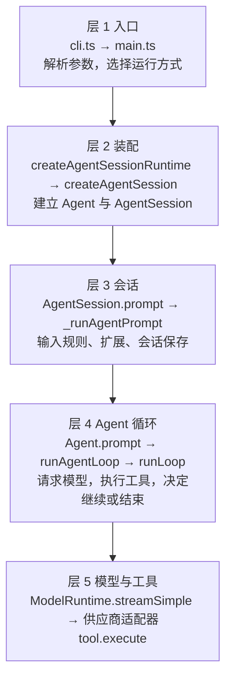
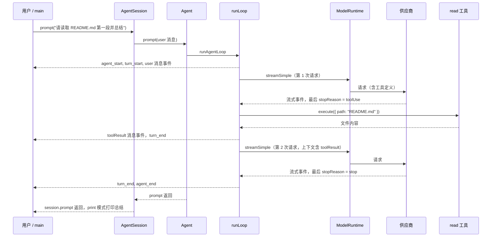

# 02. 从 CLI 到一次完整请求

> 预计时间：2 小时
> 先修：01 篇（`task-01-orientation.md`）

## 本篇你会学到

- 能说出一条用户输入从 `pi` 命令到最终回答经过的五层，以及每层的入口函数。
- 能解释"读 README 并总结"为什么要请求模型两次，每次请求发生在哪一层。
- 能用 faux 假模型（离线、按脚本回答的模型）在本地跑出同样的事件顺序，并数出模型请求次数。

## 先用一个例子理解

用户在终端里运行：

```text
pi -p "请读取 README.md 第一段并总结"
```

模型不能读你电脑上的文件。它只能输出一种意图，例如"我想调用 `read` 工具，参数是 `README.md`"。真正读文件的是本机上的 pi 进程。

所以 pi 必须依次完成四件事：

1. 解析命令行，决定运行方式。这里用 `-p`，即"执行一次，打印结果后退出"。
2. 装配好模型、设置、会话和工具。
3. 把用户输入交给会话，再交给 Agent 循环。
4. 循环先请求模型。模型要求调用 `read` 时，pi 在本地执行，把结果交回模型，模型再请求一次，给出总结。

如果没有分层，入口代码要自己请求供应商 API、执行工具、保存会话、刷新界面，全部写在一个函数里。之后每加一种运行方式（交互界面、JSON 输出、RPC），就要复制一份逻辑。分层后，每一层只做一件事，运行方式的差异只留在最外层。

分层还要处理一个更具体的情况。假设模型正在输出时，用户又输入了一句"再看一下 LICENSE"。如果这句话直接调用 `Agent.prompt()`，`Agent` 会因为已有 run 而报错，错误文字是 `Agent is already processing a prompt...`。正确做法是两层分工：

- 层 3（`AgentSession`）发现正在流式输出，把这句话放进队列，并通过 `preflightResult` 回调报告 `queued`。
- 层 4（`Agent`）只接受排队，不允许第二个 `prompt()` 与当前 run 并发修改同一份消息历史。

这里有两种队列，名字容易混：

- **steer 队列**（转向队列）：消息在当前 run 里尽快注入，不等 run 结束。适合"换个方向"这类插话。
- **follow-up 队列**（后续队列）：消息等当前 run 没有其他工作时再开始。适合"做完这个，再做那个"。

调用方用 `PromptOptions.streamingBehavior` 选择进哪个队列。如果 run 正在进行、又没有指定它，`AgentSession.prompt()` 会抛出错误。

两层各自保持简单：应用层决定"这句话怎么处理"，底层只保证"同一时间只有一个 run"。

### 读这篇的顺序建议

1. 先读下面的五层表，记住每层"收到什么、交出什么"。
2. 再读"最小跟踪"，看一条最短路径上的参数形状。
3. 然后再读完整的核心概念和 19 步走读。
4. 最后动手跑实验。实验 1 和实验 2 只需要 Node，不需要模型密钥。

下面的五层地图是这条路线的总览。后面每一节都对应其中一层。



### 五层的输入、输出与交接

每一层只回答两个问题：它收到什么，它交出什么。上一层交出的东西，就是下一层拿到的东西。读下面的表时，从上往下看，每行的最后一列对应下一行的第二列。

| 层 | 收到的输入 | 交出的输出 | 下一层拿到什么 |
| --- | --- | --- | --- |
| 1 入口（`cli.ts` → `main`） | 参数数组 `["-p", "请读取 README.md 第一段并总结"]`，以及标准输入、标准输出是否为终端 | `Args` 对象（`print: true`，`messages` 含那段文字），以及运行方式 `appMode` 为 `print` | 目录 `cwd`、`agentDir`、`sessionManager`，连同工厂函数 `createRuntime`，交给 `createAgentSessionRuntime` |
| 2 装配（`createAgentSessionRuntime`、`createAgentSession`） | 工厂函数，以及上一步的三个值 | `AgentSessionRuntime` 对象，里面有 `session`、`services`、`diagnostics` | 一个 `AgentSession`，它内部已经持有 `Agent`；入口把它交给 `runPrintMode` |
| 3 会话（`AgentSession.prompt`） | 一段用户文字（字符串） | 一条待提交的 `user` 消息；结果通过 `preflightResult` 回调报告为 `started`、`queued` 或 `handled` 之一 | `agent.prompt(messages)`，`messages` 是 `AgentMessage` 数组 |
| 4 Agent 循环（`Agent.prompt`、`runLoop`） | 消息数组，以及上下文快照（已有的 `system` 和历史消息） | 一串事件；最终的 `state.messages` | 调用 `streamFn(model, context, options)` 请求模型；把模型给出的 `toolCall` 交给工具执行 |
| 5 模型与工具（`ModelRuntime.streamSimple`、工具的 `execute`） | 模型、上下文和选项；工具名和参数 | 统一的事件流（`start`、`text_delta`、`toolcall_end`、`done` 等）；工具返回的结果对象 | 层 4 调用 `response.result()` 取得完整 assistant 消息；工具结果交给 `createToolResultMessage` 生成 `toolResult` 消息 |

注意第 1 层与第 2 层之间的一个细节：`main` 传给 `createAgentSessionRuntime` 的 `cwd` 来自 `sessionManager.getCwd()`，不是直接取自命令行。这个值就是会话记录的工作目录。选择这样做的设计理由，本篇没有逐行核对。

## 核心概念

下面六个概念是本篇的全部新词。后面的源码和实验都会用到它们。

先解释三个词。**标准输入**（stdin）是程序接收键盘或管道数据的通道；**标准输出**（stdout）是程序正常打印结果的通道；**终端**（TTY）是真正连着键盘和屏幕的输入输出设备。管道（`|`）和重定向（`>`）会让它们不再是终端。

**运行方式**（app mode）：pi 的四种运行方式，即 `interactive`（终端界面）、`print`（执行一次，输出文本）、`json`（执行一次，输出 JSON 事件）和 `rpc`（从标准输入读命令）。由 `resolveAppMode` 决定。它的作用是把"怎么接收输入、怎么输出"与"怎么跑会话"分开。`resolveAppMode` 的规则按顺序判断：`--mode rpc` 得到 `rpc`；`--mode json` 得到 `json`；`-p`，或者标准输入、标准输出任一不是终端，得到 `print`；其余情况得到 `interactive`。例子：`pi -p "..."` 选 `print`；直接运行 `pi`，且标准输入和标准输出都是终端时选 `interactive`。如果你把输出重定向到文件（例如 `pi -p "..." > out.txt`），标准输出不再是终端，这一点也会影响选择。

**会话运行时**（`AgentSessionRuntime`）：持有当前 `AgentSession` 和相关服务的外壳。它需要保存一个工厂函数（`createRuntime`），因为会话可能切换到另一个目录。例如恢复另一个项目的会话时，项目设置、资源和工具都要按新目录重建。工厂接收新的 `cwd`，重新创建一套服务。

**工厂函数**（factory）：一个函数，每次调用都创建一套新的对象。这里的 `createRuntime` 是 `main` 里的一个常量函数，每次调用都会新建设置管理器、资源加载器和模型运行时。它不是只执行一次的初始化代码，而是可以被反复调用的"配方"。

小例子：假设第一次运行时 `cwd` 是 `D:\proj-a`。用户切换到 `D:\proj-b` 的会话时，运行时调用同一个工厂，传入 `cwd: "D:\proj-b"`。于是 `proj-b` 的项目设置被读取，`proj-a` 的服务被丢弃。

**AgentSession**（应用会话）：面向"用户输入"的对象。它处理以 `/` 开头的扩展命令、模板展开、运行中排队、会话文件保存和压缩检查。它不直接请求模型，而是把准备好的消息交给 `Agent`。例如，一条 `/` 开头的扩展命令会在这里执行，并且不会发给模型。

**Agent 与 run**：`Agent` 是底层运行时，只认识消息、工具和事件，不认识文件和会话文件。一次 `Agent.prompt()` 开启一个 **run**（一次运行），从 `agent_start` 开始，到 `agent_end` 结束。同一个 `Agent` 同一时间只能有一个 run。这样做是为了避免两个 run 同时修改同一份消息历史。

**turn 与模型请求**：**turn**（轮次）指"一次模型响应，加上它引起的工具执行"。**模型请求**指发给供应商 API 的一次请求。一个 run 可以包含多个 turn。通常一个 turn 对应一次模型请求。例如"读 README 并总结"有 2 个 turn，发出 2 次模型请求。只数用户输入，会漏掉工具引起的那一次请求。

**工具调用与工具结果**：模型响应里的 `toolCall` 是一个请求，表示"我想调用 `read`，参数是 `README.md`"。pi 在本地执行它，再生成一条 `toolResult` 消息，放进上下文。模型看不到你的文件，只能通过这条结果获得文件内容。

每个工具都有一个 **schema**（参数形状的描述）。它写明参数的名字和类型，例如"`path` 必须是字符串"。pi 用它检查模型给出的参数。schema 在代码里这样写：`Type.Object({ path: Type.String() })`。`Type` 从 `packages/ai/src/index.ts` 导出，底层库是 `typebox`。实验 4 的脚本使用的就是这个写法。

> 消息（message）与事件（event）的区别，见 `task-03-messages-events-state.md`。本篇只用到它们的名字。

### 容易混淆的成对词

下面四组词在源码和讨论中经常被混用。

| 成对的词 | 区别 | 例子 |
| --- | --- | --- |
| `AgentSession.prompt()` 与 `Agent.prompt()` | 前者处理用户输入的规则（扩展命令、排队、会话保存）；后者开启一个底层 run | 扩展命令只会调用前者，不会启动 run |
| 用户请求与模型请求 | 用户只输入一次，pi 可以向模型请求多次 | 本例有 1 次用户请求，2 次模型请求 |
| turn 与 run | turn 是一轮；run 是从开始到结束的全部轮次 | 本例有 1 个 run，2 个 turn |
| 事件与消息 | 事件是过程（如 `message_update`）；消息是结果（如 `message_end` 之后的 assistant 消息） | 文字增量是事件，完整回答是消息 |

## 源码导览（按阅读顺序）

读的时候按"层"走。每个符号在文件里都能直接搜到。

| 顺序 | 文件路径 | 符号 | 读的时候关注什么 |
| --- | --- | --- | --- |
| 1 | `packages/coding-agent/src/cli.ts` | 模块顶层代码 | 层 1。入口只做两件事：启动准备，然后把参数交给 `main` |
| 2 | `packages/coding-agent/src/cli/setup.ts` | `setupCli` | 层 1。设置进程标题、两个环境变量，静音 `process.emitWarning`，并调用 `configureHttpDispatcher` 配置网络请求用的连接器 |
| 3 | `packages/coding-agent/src/cli/args.ts` | `parseArgs` | 层 1。命令行变成 `Args` 对象，并收集诊断信息 |
| 4 | `packages/coding-agent/src/main.ts` | `main` | 层 1。快速命令先返回；`cwd` 只取一次；最后按运行方式分发 |
| 5 | `packages/coding-agent/src/main.ts` | `resolveAppMode` | 层 1。该函数没有导出。`-p` 和 `--mode` 优先，否则看标准输入和输出是否为终端 |
| 6 | `packages/coding-agent/src/main.ts` | `createRuntime`（`main` 内的常量函数） | 层 2。工厂的参数（如 `cwd`）每次都由调用方传入 |
| 7 | `packages/coding-agent/src/core/agent-session-runtime.ts` | `createAgentSessionRuntime`、`AgentSessionRuntime` | 层 2。保存工厂，并在创建时调用它 |
| 8 | `packages/coding-agent/src/core/agent-session-services.ts` | `createAgentSessionServices`、`createAgentSessionFromServices` | 层 2。先建服务（设置、资源、模型运行时），再建会话 |
| 9 | `packages/coding-agent/src/core/sdk.ts` | `createAgentSession` | 层 2。真正 `new Agent(...)` 和 `new AgentSession(...)` 的地方；CLI 与 SDK 都走它 |
| 10 | `packages/coding-agent/src/modes/print-mode.ts` | `runPrintMode` | 层 1 到层 3 的接口。调用 `session.prompt`，文本模式在返回后打印结果 |
| 11 | `packages/coding-agent/src/core/agent-session.ts` | `AgentSession`、`prompt`、`_runAgentPrompt` | 层 3。输入规则，以及 run 结束后的收尾循环 |
| 12 | `packages/coding-agent/src/core/agent-session.ts` | `_handleAgentEvent` | 层 3。订阅 Agent 事件：先转发，后保存消息 |
| 13 | `packages/agent/src/agent.ts` | `Agent`、`prompt`、`runPromptMessages`、`runWithLifecycle`、`processEvents` | 层 4。一次只跑一个 run；先更新状态，再通知监听器 |
| 14 | `packages/agent/src/agent-loop.ts` | `runAgentLoop`、`runLoop`、`streamAssistantResponse` | 层 4。双层循环；决定继续请求模型还是结束 |
| 15 | `packages/agent/src/agent-loop.ts` | `executeToolCalls`、`prepareToolCall`、`createToolResultMessage` | 层 5。工具批次调度，以及工具结果消息的生成 |
| 16 | `packages/coding-agent/src/core/model-runtime.ts` | `ModelRuntime`、`streamSimple` | 层 5。解析认证，调用供应商的流式接口 |
| 17 | `packages/ai/src/compat.ts` | `streamSimple` | 层 5。默认流函数，供没有显式 `streamFn` 的 Agent 使用 |
| 18 | `packages/ai/src/api/anthropic-messages.ts` | `streamSimple` | 层 5。一个供应商适配器：把统一请求转成供应商请求，再把供应商流转回统一事件 |
| 19 | `packages/ai/src/providers/faux.ts` | `fauxProvider`、`fauxAssistantMessage`、`fauxToolCall` | 离线假模型。本篇的实验用它 |

### 如何在仓库里搜索这些符号

用 `Select-String`（PowerShell）或 `grep -n`（bash）即可。例如：

```powershell
Select-String -Path packages/coding-agent/src/main.ts -Pattern "function resolveAppMode|export async function main"
```

```bash
grep -n "function resolveAppMode\|export async function main" packages/coding-agent/src/main.ts
```

搜索时注意两点。第一，同名函数可能出现在不相关的文件里：`parseArgs` 不仅在 `cli/args.ts` 中，`experimental` 目录下也有。所以要带上文件路径。第二，`resolveAppMode` 没有 `export`，其他文件无法导入它，只能在 `main.ts` 里看到定义。

## 走读一次完整过程

下面以 `pi -p "请读取 README.md 第一段并总结"` 为例。每一步写三件事：发生了什么、对应哪个函数、状态有什么变化。

### 最小跟踪：只看参数的形状

完整的 19 步很长。先看一条最短的路径，只关心"每个函数收到什么参数，交出什么结果"。下面的输出来自本机真实运行（实验 4 的脚本）。路径里的临时目录因机器而异，用 `<临时目录>` 代替。

1. **命令行进入 `main`。** `cli.ts` 调用 `main(process.argv.slice(2))`。`process.argv` 是 Node 收到的全部命令行参数，前两项是 Node 自己和脚本的路径，`slice(2)` 去掉它们。这一步的参数是：

```text
["-p", "请读取 README.md 第一段并总结"]
```

2. **`parseArgs` 解析参数。** 看到 `-p` 后，`print` 设为 `true`，后面的文字被放进 `messages`。`main` 得到的 `parsed` 大致是：

```text
{ print: true, messages: ["请读取 README.md 第一段并总结"], ... }
```

省略号表示还有其他字段（如 `version`、`mode`），本例没有用到。

3. **`runPrintMode` 逐条提交。** `main` 调用 `runPrintMode(runtime, { mode, messages, initialMessage, initialImages })`。`mode` 由 `toPrintOutputMode(appMode)` 得到，本例是 `"text"`；只有 `json` 运行方式得到 `"json"`。`runPrintMode` 对每条消息调用 `session.prompt(message)`，参数是一个字符串。

4. **`AgentSession.prompt` 组装消息。** 文字不以 `/` 开头，没有扩展命令，也没有模板需要展开，于是直接组装成一条 user 消息。`Agent` 收到的数组形状大致如下（省略了时间戳等字段）：

```text
[{ role: "user", content: [{ type: "text", text: "请读取 README.md 第一段并总结" }] }]
```

5. **第 1 次模型请求，模型返回 `toolCall`。** 模型不直接返回文件内容，而是返回一个工具调用块。下面这一行是本机真实运行的结果。它由脚本里的 `fauxToolCall` 生成，模拟真实模型的输出：

```text
{"type":"toolCall","id":"call_1","name":"read","arguments":{"path":"<临时目录>\\README.md"}}
```

`arguments` 就是工具的参数对象，它的形状由工具的 schema 决定。内置的 `read` 工具（`packages/coding-agent/src/core/tools/read.ts`）的参数是：`path`（必填，描述写着"相对或绝对路径"），以及可选的 `offset` 和 `limit`。

6. **pi 调用 `read` 工具。** `executePreparedToolCall` 调用 `prepared.tool.execute(toolCall.id, args, signal, onUpdate)`。本机真实输出：

```text
EXECUTE id=call_1 args={"path":"<临时目录>\\README.md"}
```

四个参数依次是：`toolCall.id`（让结果能和请求配对）、`args`（参数对象）、`signal`（取消信号）、`onUpdate`（进度回调，本例没有用到）。

7. **生成 `toolResult`。** `createToolResultMessage` 生成 `role` 为 `toolResult` 的消息，它的 `toolCallId` 与第 5 步的 `id` 相同，内容是工具返回的文件文本。这条消息被追加到上下文，模型第二次请求时会看到它。

8. **第 2 次模型请求，模型给出总结。** 本机真实输出：

```text
ASSISTANT_STOP_REASON=stop
LAST_CONTENT=[{"type":"text","text":"总结：第一段。"}]
```

`stop` 表示这次回答正常结束，没有新的工具调用。这里的回答文字是脚本预设的，不是真实模型生成的。

把 8 步合起来，就是"模型先要求读文件，pi 读完后交还结果，模型再总结"。下面的五层走读，每一步都是这条路径上的某个函数。

### 层 1：入口

这一层解决的问题是"哪些命令根本不需要会话"。`pi --version` 只需要打印版本号。如果它也创建会话、加载扩展，启动会变慢，而且没有意义。所以入口先处理快速命令，只有真正要运行时才往下走。

**步骤 1：进程启动。** Node 运行 `packages/coding-agent/src/cli.ts`。它先调用 `setupCli()`，再调用 `main(process.argv.slice(2))`。`setupCli` 会设置进程标题为 `pi`，写入环境变量 `PI_CODING_AGENT=true` 和 `AI_AGENT=pi`，并把 `process.emitWarning` 换成空函数。状态变化：进程环境多了两个标记，后续的警告不再输出。

**步骤 2：解析参数。** `main` 先处理 `--offline`，以及 `pi auth` 之类的快速命令。然后调用 `parseArgs`，把 `-p` 和后面的文本变成 `Args` 对象（`parsed.print` 为真，`parsed.messages` 含这段文本）。诊断信息（如未知参数）在这里收集。`--version` 也在这一步返回，不创建会话。状态变化：得到 `parsed` 对象。

**步骤 3：选择运行方式。** `main` 调用 `resolveAppMode(parsed, process.stdin.isTTY, process.stdout.isTTY)`，结果是 `print`。因为不是交互方式，`main` 调用 `takeOverStdout()`（位于 `packages/coding-agent/src/core/output-guard.ts`）。它把 `process.stdout.write` 改为写到标准错误，同时保留原始写入函数 `writeRawStdout`。普通输出（包括 `console.log`）因此进入标准错误；标准输出只留给协议数据和最终结果。状态变化：`appMode` 为 `print`；标准输出被接管。

### 层 2：装配

这一层解决的问题是"同一套会话，怎样既能一次性使用，又能在切换目录后重建"。CLI 需要后者；SDK 调用方通常只需要前者。两条路径最终都进入 `createAgentSession`，区别在于 CLI 保留了一个可以再次调用的工厂。

**步骤 4：建立会话运行时。** `main` 定义常量函数 `createRuntime`。它接收一个对象，里面有 `cwd`、`agentDir`、`sessionManager` 等字段，负责创建服务和会话。然后 `main` 调用 `createAgentSessionRuntime(createRuntime, { cwd: sessionManager.getCwd(), agentDir, sessionManager })`。`createAgentSessionRuntime` 把工厂保存在 `AgentSessionRuntime` 里，并立即调用一次。状态变化：`runtime` 对象出现，里面有 `session`、`services` 和 `diagnostics`。

**步骤 5：创建服务。** 工厂先调用 `createAgentSessionServices`。它准备设置管理器、资源加载器（扩展、技能、提示词模板、上下文文件）和模型运行时（`ModelRuntime`）。这些是"与目录相关"的部件，切换会话目录时需要重建。

**步骤 6：创建会话。** 然后工厂调用 `createAgentSessionFromServices`。它把已建好的服务传给 `sdk.ts` 中的 `createAgentSession`。SDK 调用方直接调用 `createAgentSession`，走的是同一段代码。

**步骤 7：创建 Agent 与 AgentSession。** 在 `createAgentSession` 中，代码先选定模型和思考级别，再创建 `Agent`：

- `streamFn` 是一个包装函数。它先启动缓存预热，然后调用 `modelRuntime.streamSimple`。
- `convertToLlm` 把内部消息转换为模型消息。
- `transformContext` 调用扩展的上下文钩子。

接着创建 `AgentSession`，把 `agent`、`sessionManager` 和 `settingsManager` 传进去。`AgentSession` 的构造函数执行 `this.agent.subscribe(this._handleAgentEvent)`，订阅 Agent 的事件。另外，`sdk.ts` 顶部执行 `setDefaultStreamFn(streamSimple)`，为没有显式 `streamFn` 的 Agent 设置默认流函数。

状态变化：`Agent` 的初始状态由 `createMutableAgentState`（位于 `packages/agent/src/agent.ts`）创建。它把 `systemPrompt` 和工具声明生成的一条 `system` 消息插入 `state.messages` 开头。这条消息不是通过事件产生的，实验 2 会看到这一点。

### 层 3：AgentSession

这一层解决的问题是"用户输入不等于一次模型请求"。以 `/` 开头的扩展命令要直接执行；模板要先展开；运行中的输入要排队；上一次响应被取消后留下的历史可能需要先压缩。这些都必须在调用模型之前处理完。

先解释两个词。**扩展**（extension）是插件代码，可以注册命令，也可以挂接钩子。**钩子**（hook）是扩展提供的一个函数，pi 在某个固定时机调用它。例如 `before_agent_start` 是"run 开始前"的时机，它对应源码中的 `emitBeforeAgentStart`。

**步骤 8：交给运行方式。** `main` 调用 `runPrintMode(runtime, { mode, messages, initialMessage, initialImages })`（位于 `packages/coding-agent/src/modes/print-mode.ts`）。`mode` 是 `"text"` 或 `"json"`，`messages` 来自 `parsed.messages`。`runPrintMode` 对每条消息调用 `session.prompt(message)`。`print` 模式这样做。交互模式（`packages/coding-agent/src/modes/interactive/interactive-mode.ts`）也调用 `session.prompt`，只是调用的时机不同。它在运行中提交输入时，会传入 `streamingBehavior: "steer"` 或 `"followUp"`，对应两种队列（源码中共有这两类调用，具体的按键处理位置未逐行核对）。RPC 模式的调用处本篇未核对。

**步骤 9：输入规则。** `AgentSession.prompt(text)` 按顺序检查和处理：

1. 如果正在做 `agent_settled` 的收尾工作，把这次输入放到延后队列。
2. 如果以 `/` 开头且是扩展命令，执行命令，并报告 `handled`。
3. 如果正在压缩上下文，抛出错误，拒绝提交。
4. 运行扩展的输入钩子，它可能改写或取消输入。
5. 展开 `/skill:...` 和提示词模板。
6. 如果 Agent 正在运行，按 `streamingBehavior` 把输入排入 steer 或 follow-up 队列，报告 `queued`。
7. 冲刷之前积累的 bash 输出和自定义消息。
8. 检查模型已选定，且该供应商的认证可用。
9. 检查上一次响应留下的历史是否需要先压缩。
10. 调用扩展的 `before_agent_start` 钩子。
11. 把用户文本组装成一条 `user` 消息，图片作为内容块附在后面。
12. 报告 `started`，然后调用 `_runAgentPrompt(messages)`。

本例没有命中第 1、2、3、6 步，所以一直走到第 12 步。状态变化：待提交的消息数组里有一条 `user` 消息。

**步骤 10：run 的收尾循环。** `_runAgentPrompt` 把消息交给 `this.agent.prompt(messages)`。`agent.prompt()` 返回后，它不立刻结束，而是检查三类后续工作：自动重试、自动压缩、排队中的消息。如果有，就调用 `this.agent.continue()` 再跑一次；如果没有，调用 `_emitAgentSettled()`，然后返回。

所以 `session.prompt()` 返回时，表示"整个会话级工作都结束了"，而不是"第一次模型响应结束了"。

为什么 `agent.prompt()` 返回后还要检查？设想第一次模型请求因为网络抖动失败。`Agent` 的 run 以错误结束，但这个错误是可以重试的。`_handlePostAgentRun` 判断可以重试，于是 `_runAgentPrompt` 调用 `agent.continue()`，在同一会话里再跑一次，不新增用户消息。这就是 `session.prompt()` 的返回时机晚于 `agent.prompt()` 的原因。

### 层 4：Agent 循环

这一层解决的问题是"下一步是请求模型还是结束"。每次模型响应之后，pi 要判断三件事：有没有工具要执行；工具执行完后是否还要再问模型；有没有排队中的消息。这些判断都集中在 `runLoop` 中。

先解释两个词。**监听器**（listener）是用 `subscribe` 注册的回调，`Agent` 每发出一个事件，都会依次调用它。**AbortController**（取消控制器）是 JavaScript 内置的取消开关：调用 `abort()` 后，它的 `signal`（取消信号）变为已取消。pi 把这个 `signal` 传给模型请求和工具，它们可以自己检查并停止。

这一层的白话版本：`Agent` 像一个小型调度员。它不知道文件和会话，只知道"发消息给模型，拿到工具调用，执行工具，再发消息给模型，直到模型不再要工具为止"。

**步骤 11：开始 run。** `Agent.prompt(input)` 先检查 `activeRun`。如果已有 run，抛出 `Agent is already processing a prompt...` 错误。然后 `normalizePromptInput` 把输入规范化为消息数组。`runPromptMessages` 调用 `runWithLifecycle`，后者创建 `activeRun`（包含一个 `AbortController`），把 `state.isStreaming` 设为 `true`，然后调用：

```text
runAgentLoop(messages, 上下文快照, 循环配置, 事件处理函数, signal, streamFunction)
```

其中事件处理函数是 `processEvents`。这意味着循环发出的每个事件，都先经过 `processEvents` 更新状态。

**步骤 12：开始事件。** `runAgentLoop` 依次发出 `agent_start`、`turn_start`，然后对每条初始消息发出 `message_start` 和 `message_end`。对用户消息，`processEvents` 在 `message_end` 时把它追加到 `state.messages`。

**步骤 13：第 1 次模型请求。** `runLoop` 进入内层循环，调用 `streamAssistantResponse`。它依次执行：

1. `transformContext`：扩展可以变换消息列表。
2. `convertToLlm`：过滤并转换为模型消息。
3. 解析 API key（每次请求都解析，因为 OAuth 令牌可能需要刷新）。
4. 调用 `streamFunction`，即步骤 7 中 `sdk.ts` 的包装函数。

状态变化：模型开始返回时，`message_start` 带来一条临时的 assistant 消息，它被放在 `context.messages` 末尾。每个增量产生一个 `message_update`，`processEvents` 把最新快照写入 `state.streamingMessage`。

### 层 5：模型与工具

这一层解决的问题是"不同供应商的接口格式各不相同"。**供应商**（provider）指提供模型的公司或服务，例如 Anthropic、OpenAI。每家的请求格式和返回格式都不同。

**流**（stream）指模型边生成边返回的数据，而不是等全部生成完才返回一个整体。pi 用流接收文字增量（`text_delta`）。

**适配器**（adapter）是一段翻译代码，把某家供应商的格式转换成 pi 统一的格式。`packages/ai/src/api/anthropic-messages.ts` 就是 Anthropic 的适配器。它把供应商的流式数据转成统一事件（`start`、`text_delta`、`toolcall_end`、`done` 等），上层的 `Agent` 只处理统一事件，不需要知道供应商的细节。

这就是这一层存在的目的：供应商之间的格式差异停在适配器里。本篇没有新增一家供应商来验证这一点（未在本地验证）。

**步骤 14：模型层。** `sdk.ts` 中的 `streamFn` 调用 `modelRuntime.streamSimple(model, context, requestOptions)`（位于 `packages/coding-agent/src/core/model-runtime.ts`）。`ModelRuntime` 解析认证，找到对应的供应商，再调用供应商的 `streamSimple`。供应商适配器（如 `packages/ai/src/api/anthropic-messages.ts`）把供应商的流式数据转换为统一事件：`start`、`text_delta`、`toolcall_end`、`done` 等。

**步骤 15：第 1 次响应结束。** `streamAssistantResponse` 收到 `done` 事件后，调用 `response.result()` 取得完整 assistant 消息，并发出 `message_end`。最终消息替换 `context.messages` 中的临时消息。这条消息的 `stopReason` 是 `toolUse`，内容里有一个 `toolCall`。

**步骤 16：执行工具。** `runLoop` 检测到 `toolCall`，调用 `executeToolCalls`。如果批次中没有 `sequential` 工具，也没有全局的顺序设置，就调用 `executeToolCallsParallel`。对每个调用：

1. `prepareToolCall` 按名字查找工具（这里是 `read`），用 schema 校验参数，然后调用 `beforeToolCall`。`AgentSession` 把 `_beforeToolCall` 挂在这个钩子上。
2. `executePreparedToolCall` 调用工具的 `execute` 方法，读取文件内容。
3. `finalizeExecutedToolCall` 调用 `afterToolCall`，它可以改写结果。
4. `createToolResultMessage` 生成 `role: "toolResult"` 的消息，并与对应的 `toolCallId` 关联。

每一步都会发出事件，例如 `tool_execution_start`、`tool_execution_end`，以及 `toolResult` 的 `message_start` 和 `message_end`。状态变化：`toolResult` 被追加到 `currentContext.messages` 和 `newMessages`。

**错误是结果，不是崩溃。** 设想模型调用了一个不存在的工具 `grep2`。`prepareToolCall` 不会让进程退出，而是返回一个 `isError: true` 的结果，文本是 `Tool grep2 not found`。这条结果进入上下文，模型看到后可以改用 `grep`。单个工具失败不会结束 run。

**步骤 17：第 2 次模型请求。** 工具执行后，`hasMoreToolCalls` 为 `true`，内层循环再次运行。`turn_end` 之后，`turn_start` 再次发出，`streamAssistantResponse` 第二次调用模型。这次上下文里有 4 条消息：`system`、`user`、`assistant`（带 `toolCall`）和 `toolResult`。模型给出总结，`stopReason` 为 `stop`，没有 `toolCall`。

随后 `finishTurn` 不要求继续，没有排队消息，内层循环结束。没有 follow-up 消息，外层循环也结束，`runLoop` 发出 `agent_end`。

**步骤 18：会话保存与收尾。** 每个 `message_end` 都会到达 `AgentSession._handleAgentEvent`。它按顺序做三件事：先调用 `_emitExtensionEvent`，再把事件公开派发给订阅者（`_emit`），最后对 `user`、`assistant`、`toolResult` 调用 `sessionManager.appendMessage` 写入会话文件。`agent.prompt()` 返回后，`_runAgentPrompt` 检查是否有后续工作，没有则发出 `agent_settled`，`session.prompt()` 返回。

**步骤 19：打印结果。** `runPrintMode` 在 `session.prompt()` 返回后，读取 `session.state.messages` 的最后一条消息。如果它是 assistant 消息且 `stopReason` 不是 `error` 或 `aborted`，就通过 `writeRawStdout` 把其中的文本内容写到真正的标准输出。文本模式不会在过程中逐字输出，所以 print 模式下看不到打字效果；交互模式才会。状态变化：标准输出出现一段总结，进程正常退出。

### 小结：两次请求的来源

| 项目 | 数量 | 来源 |
| --- | --- | --- |
| 用户请求 | 1 | 命令行的一段文字 |
| run | 1 | 一次 `Agent.prompt()` |
| turn | 2 | 第 1 个：请求并调用 `read`；第 2 个：给出总结 |
| 模型请求 | 2 | 每个 turn 各一次 |
| 工具执行 | 1 | `read` |

第二次请求的原因很直接：第一次响应里只有"我要调用 `read`"，没有文件内容。pi 必须执行工具，把结果放进上下文，模型才能总结。

下面的时序图把两次请求和五层放在同一张图里。箭头表示调用，虚线表示返回或事件。



### 真实运行的事件顺序

下面是实验 2 中 tool 场景的真实输出（去掉了 `message_update`，见实验说明）。第一行到第五行是进入第 1 次请求之前的事件。

```text
EVENT agent_start
EVENT turn_start
EVENT message_start role=user
EVENT message_end role=user
MODEL_REQUEST #1 context_messages=2
EVENT message_start role=assistant
EVENT message_end role=assistant
EVENT tool_execution_start
EVENT tool_execution_end
EVENT message_start role=toolResult
EVENT message_end role=toolResult
EVENT turn_end role=assistant
EVENT turn_start
MODEL_REQUEST #2 context_messages=4
EVENT message_start role=assistant
EVENT message_end role=assistant
EVENT turn_end role=assistant
EVENT agent_end
```

读这段输出时注意三点：

- `turn_start` 出现 2 次，`MODEL_REQUEST` 出现 2 次。一个 turn 对应一次模型请求。
- 第 1 次请求的上下文有 2 条消息（`system` 和 `user`）。第 2 次有 4 条（再加上 `assistant` 和 `toolResult`）。
- 用户消息的事件只有一对 `message_start` 和 `message_end`，`system` 消息没有事件。

把这些事件对应到"模型看到的消息"，就是下面的表。`context_messages` 和 `FINAL_MESSAGES` 都来自实验 2 的输出：

| 时点 | 发给模型的消息数（`context_messages`） | 消息角色 | 说明 |
| --- | --- | --- | --- |
| 第 1 次请求 | 2 | `system`、`user` | 用户消息在它的 `message_end` 事件时加入状态 |
| 第 2 次请求 | 4 | `system`、`user`、`assistant`、`toolResult` | 工具结果已加入，模型才能总结 |
| run 结束 | 不适用 | `system,user,assistant,toolResult,assistant`（`FINAL_MESSAGES`） | 最后一条 assistant 是总结 |

### 每一层的白话总结

下面按层再说一遍。每段回答四个问题：没有这一层会怎样，它做什么，读源码时先看哪个函数，以及最容易想错的一点。

**层 1：入口。** 没有它，`pi --version` 也会创建会话、读取配置和扩展，启动慢，而且没有必要。它做两件事：先处理不需要会话的快速命令，然后决定运行方式（`resolveAppMode`）。读源码时先看 `main`（`packages/coding-agent/src/main.ts`）的开头，那里有快速返回的分支。

容易想错的一点：`-p` 不是"打印"，而是 `print` 运行方式的开关，意思是"执行一次后退出"。

**层 2：装配。** 没有它，每次切换目录都要手动重新读取设置、扩展和技能，并重建模型运行时。它把"与目录相关的服务"放进工厂函数，需要时再调用一次。读源码时先看 `createAgentSessionRuntime`（`packages/coding-agent/src/core/agent-session-runtime.ts`）。

容易想错的一点：runtime 不是 session。runtime 是外壳，里面的 `session` 才是 `AgentSession`。`AgentSessionRuntime` 接口中同时有 `session`、`services` 和 `diagnostics` 三个字段。

**层 3：AgentSession。** 没有它，用户输入一到就直接请求模型：`/` 开头的扩展命令会被当作普通文字发给模型，运行中的输入会直接报错。它把"用户输入怎么处理"的规则集中在一处。读源码时先看 `AgentSession.prompt`（`packages/coding-agent/src/core/agent-session.ts`）。

容易想错的一点：`session.prompt()` 返回，不代表模型已经回答完。它返回时，重试、压缩和排队消息等会话级工作都已经结束。

**层 4：Agent 循环。** 没有它，"请求模型、执行工具、再请求"这个循环就要在每种运行方式里各写一遍。它只认识消息、工具和事件，所以 CLI、SDK 和测试可以共用。读源码时先看 `runLoop`（`packages/agent/src/agent-loop.ts`）。

容易想错的一点：一个 run 不等于一次模型请求。一个 run 可以有多个 turn，每个 turn 通常对应一次模型请求。

**层 5：模型与工具。** 没有它，每接入一家供应商，循环里都要写一套该供应商的请求和解析代码；每个工具也要自己处理参数校验和结果格式。它把供应商差异压到适配器里，把工具执行统一成 `execute` 调用。读源码时先看 `streamSimple`（`packages/ai/src/compat.ts`）和 `executePreparedToolCall`（`packages/agent/src/agent-loop.ts`）。

容易想错的一点：工具执行的结果带有 `isError` 字段（见 `executePreparedToolCall` 的返回值）。它表示"这次工具调用失败了"，但 run 本身不会因此立刻结束，模型还能读到这条结果。

### 读源码的四个练习

下面四个练习只用 `grep`，不需要运行。括号里是本篇已经看到过的结果，用来核对你的操作。

1. 找出 `createAgentSessionRuntime` 在 `main` 中的调用位置：`grep -n "createAgentSessionRuntime(" packages/coding-agent/src/main.ts`。（本篇看到：只有一处调用，位于 `main` 内部，传入的 `cwd` 来自 `sessionManager.getCwd()`。）
2. 找出 `runLoop` 调用 `streamAssistantResponse` 的地方，数一数有几处。这一步没有给出标准答案，请和选读 3 的表格对照。
3. 找出 `Agent is already processing` 这段文字在仓库里出现的位置：`grep -rn "Agent is already processing" packages`。（本篇看到：至少两处。`packages/agent/src/agent.ts` 中有 `prompt` 的守卫；`packages/coding-agent/src/core/agent-session.ts` 中有要求指定 `streamingBehavior` 的错误。）
4. 找出 `stopReason` 被判断为 `toolUse` 的地方，读它后面的分支。它决定了循环是否去执行工具。

### 读源码时的三个陷阱

- 同名函数不一定是同一个。`parseArgs` 在 `cli/args.ts` 之外，还有 `experimental` 目录下的两个版本。
- 看到 `await` 不等于等到了模型回答。`await session.prompt()` 等的是整个会话级工作，而 `await agent.prompt()` 等的是一个 run。
- 事件名称容易误会。`message_end` 表示一条消息的内容已经确定，但它不保证会话文件已经写完；会话文件的写入发生在 `AgentSession` 的事件处理里（见 `_handleAgentEvent`）。

## 动手实验

这些实验只用离线假模型，不需要 API key。实验 1 只调用 CLI 的快速路径。实验 2 直接使用 `packages/agent` 的 `Agent`，因此只覆盖层 4 和层 5，不经过 CLI 和 `AgentSession`。

### 实验 1：确认入口与快速路径（约 5 分钟）

**目的**：确认 `cli.ts` → `main` 的启动路径，并看到 `--version` 在创建会话之前返回。

**步骤**：在仓库根目录执行。`PI_CODING_AGENT_DIR` 把全局配置目录指向临时目录，避免读写真实的 `~/.pi/agent`。

PowerShell：

```powershell
$env:PI_CODING_AGENT_DIR = Join-Path $env:TEMP ("pi-agent-" + [guid]::NewGuid().ToString("N"))
node packages/coding-agent/src/cli.ts --version
Remove-Item -Recurse -Force -ErrorAction SilentlyContinue $env:PI_CODING_AGENT_DIR
Remove-Item Env:PI_CODING_AGENT_DIR
```

bash：

```bash
export PI_CODING_AGENT_DIR="$(mktemp -d)"
node packages/coding-agent/src/cli.ts --version
rm -rf "$PI_CODING_AGENT_DIR"
unset PI_CODING_AGENT_DIR
```

**预期输出**：标准输出只有一行版本号 `1.0.2`，退出码为 0。本篇在 Node v23.9.0 的 bash 中运行得到了这个结果。标准错误中会有两行 `ExperimentalWarning: Type Stripping`，它是 Node 对 `.ts` 直接运行的提示，与结果无关，加 `2>/dev/null` 可以隐藏。版本号来自 `packages/coding-agent/package.json`，以你本地为准。PowerShell 版本本篇未运行（未在本地验证）。

**版本要求**：`packages/coding-agent/package.json` 的 `engines.node` 写的是 `>=22.19.0`。如果你的 Node 更低，直接运行 `.ts` 文件可能失败（本篇未在低版本上验证）。

**对照源码**：`main` 在 `parsed.version` 分支中调用 `console.log(VERSION)` 后直接退出，位于 `createAgentSessionRuntime` 之前。

### 实验 2：离线跑通"读文件再回答"（约 15 分钟）

**目的**：用 faux 假模型跑 `Agent` 循环，数出模型请求次数，并确认事件顺序与上一节一致。

**步骤**：

1. 把下面的脚本保存为系统临时目录中的 `pi-task02-trace.ts`。bash 下位置是 `$TEMP/pi-task02/`，PowerShell 下位置是 `$env:TEMP\pi-task02\`。先创建该目录（bash：`mkdir -p "$TEMP/pi-task02"`；PowerShell：`New-Item -ItemType Directory -Force "$env:TEMP\pi-task02"`）。如果仓库不在 `D:/Github/pi`，改脚本开头两行的路径。

```typescript
import { mkdtempSync, readFileSync, rmSync, writeFileSync } from "node:fs";
import { tmpdir } from "node:os";
import { join } from "node:path";
import { fauxAssistantMessage, fauxProvider, fauxToolCall, Type } from "file:///D:/Github/pi/packages/ai/src/index.ts";
import { Agent } from "file:///D:/Github/pi/packages/agent/src/index.ts";

const scenario = process.argv[2] === "text" ? "text" : "tool";
const dir = mkdtempSync(join(tmpdir(), "pi-task02-"));
const readmePath = join(dir, "README.md");
writeFileSync(readmePath, "# Demo\nFirst paragraph.\n");

const faux = fauxProvider();
const model = faux.getModel();
faux.setResponses(
	scenario === "tool"
		? [
				fauxAssistantMessage([fauxToolCall("read", { path: readmePath })], { stopReason: "toolUse" }),
				fauxAssistantMessage("总结：这是 README 的第一段。"),
			]
		: [fauxAssistantMessage("直接回答。")],
);

const readTool = {
	name: "read",
	label: "Read",
	description: "Read a text file",
	parameters: Type.Object({ path: Type.String() }),
	execute: async (_id: string, args: { path: string }) => ({
		content: [{ type: "text" as const, text: readFileSync(args.path, "utf8") }],
		details: undefined,
	}),
};

let modelRequests = 0;
let textDeltas = 0;
const agent = new Agent({
	initialState: { systemPrompt: "demo", model, tools: scenario === "tool" ? [readTool] : [], messages: [] },
	streamFn: (m, ctx, opts) => {
		modelRequests++;
		console.log(`MODEL_REQUEST #${modelRequests} context_messages=${ctx.messages.length}`);
		return faux.provider.streamSimple(m, ctx, opts);
	},
});
agent.subscribe((event) => {
	if (event.type === "message_update") {
		textDeltas++;
		return;
	}
	const role = "message" in event ? ` role=${event.message.role}` : "";
	console.log(`EVENT ${event.type}${role}`);
});

await agent.prompt("请读取 README.md 第一段并总结");
console.log(`MESSAGE_UPDATE_COUNT=${textDeltas}`);
console.log(`TOTAL_MODEL_REQUESTS=${modelRequests}`);
console.log(`FINAL_MESSAGES=${agent.state.messages.map((m) => m.role).join(",")}`);
rmSync(dir, { recursive: true, force: true });
```

2. 运行两个场景。`tool` 场景是"第 1 次返回 `read` 调用，第 2 次返回总结"；`text` 场景是"只返回一段文字"。

bash：

```bash
cd "$TEMP/pi-task02" && node pi-task02-trace.ts tool 2>/dev/null
cd "$TEMP/pi-task02" && node pi-task02-trace.ts text 2>/dev/null
```

PowerShell：

```powershell
Set-Location "$env:TEMP\pi-task02"
node pi-task02-trace.ts tool 2>$null
node pi-task02-trace.ts text 2>$null
```

3. 清理。bash 用 `rm -rf "$TEMP/pi-task02"`；PowerShell 用 `Remove-Item -Recurse -Force "$env:TEMP\pi-task02"`。

**预期输出（真实运行结果）**：`tool` 场景的输出见上一节"真实运行的事件顺序"，末尾三行为：

```text
MESSAGE_UPDATE_COUNT=11
TOTAL_MODEL_REQUESTS=2
FINAL_MESSAGES=system,user,assistant,toolResult,assistant
```

`text` 场景的输出如下：

```text
EVENT agent_start
EVENT turn_start
EVENT message_start role=user
EVENT message_end role=user
MODEL_REQUEST #1 context_messages=2
EVENT message_start role=assistant
EVENT message_end role=assistant
EVENT turn_end role=assistant
EVENT agent_end
MESSAGE_UPDATE_COUNT=3
TOTAL_MODEL_REQUESTS=1
FINAL_MESSAGES=system,user,assistant
```

**说明**：

- `message_update` 每个文本增量产生一条。同一脚本在本机的 bash 运行中得到 11 条，在 PowerShell 运行中得到 12 条。数量不固定，不要把它当作断言；`TOTAL_MODEL_REQUESTS` 和事件顺序才是要核对的内容。
- Node 23 会在标准错误输出 `ExperimentalWarning: Type Stripping`，这是 Node 的类型剥离提示，与本实验无关。`2>/dev/null` 或 `2>$null` 把它隐藏。
- `FINAL_MESSAGES` 中的 `system` 来自 `Agent` 构造时的初始状态，它没有对应的 `message_start`/`message_end` 事件。

**读结果**：

- `tool` 场景两次请求，`text` 场景一次请求。区别完全来自"模型是否返回 `toolCall`"。
- `text` 场景没有 `tool_execution_*` 事件，也没有第二次请求。这证明：工具调用是额外请求的唯一来源（在本脚本的设置下）。

### 实验 3：在源码中核对流函数的接缝（约 3 分钟）

**目的**：确认 `sdk.ts` 里的 `streamFn` 确实指向 `modelRuntime.streamSimple`，并且默认流函数来自 `packages/ai/src/compat.ts`。

PowerShell：

```powershell
Select-String -Path packages/coding-agent/src/core/sdk.ts -Pattern "setDefaultStreamFn|modelRuntime.streamSimple"
```

bash：

```bash
grep -n "setDefaultStreamFn\|modelRuntime.streamSimple" packages/coding-agent/src/core/sdk.ts
```

**预期输出**：两行，分别包含 `setDefaultStreamFn(streamSimple)` 和 `return modelRuntime.streamSimple(model, context, requestOptions);`。两种 shell 的输出格式略有不同（PowerShell 带文件名和行号前缀），内容相同。

### 实验 4：看工具调用的参数形状，并制造一次"响应不够"（约 5 分钟）

**目的**：确认 `toolCall` 块的形状、工具收到的参数，以及脚本给的模型响应比请求次数少时会发生什么。

**步骤**：把下面的脚本保存为 `$TEMP/pi-task02/pi-task02-shape.ts`（bash 和 PowerShell 的文件内容相同）。脚本里的 import 路径写的是 `D:/Github/pi`，如果仓库在别处，要改这两行。

```typescript
import { mkdtempSync, readFileSync, rmSync, writeFileSync } from "node:fs";
import { tmpdir } from "node:os";
import { join } from "node:path";
import { fauxAssistantMessage, fauxProvider, fauxToolCall, Type } from "file:///D:/Github/pi/packages/ai/src/index.ts";
import { Agent } from "file:///D:/Github/pi/packages/agent/src/index.ts";

const mode = process.argv[2] === "short" ? "short" : "shape";
const dir = mkdtempSync(join(tmpdir(), "pi-task02-shape-"));
const readmePath = join(dir, "README.md");
writeFileSync(readmePath, "# Demo\nFirst paragraph.\n");

const faux = fauxProvider();
const model = faux.getModel();
const toolCall = fauxToolCall("read", { path: readmePath }, { id: "call_1" });
console.log(`TOOLCALL_BLOCK=${JSON.stringify(toolCall)}`);

// "short" gives only the first response, so the second model request has no script left.
faux.setResponses(
	mode === "shape"
		? [fauxAssistantMessage([toolCall], { stopReason: "toolUse" }), fauxAssistantMessage("总结：第一段。")]
		: [fauxAssistantMessage([toolCall], { stopReason: "toolUse" })],
);

const readTool = {
	name: "read",
	label: "Read",
	description: "Read a text file",
	parameters: Type.Object({ path: Type.String() }),
	execute: async (id: string, args: { path: string }) => {
		console.log(`EXECUTE id=${id} args=${JSON.stringify(args)}`);
		return { content: [{ type: "text" as const, text: readFileSync(args.path, "utf8") }], details: undefined };
	},
};

const agent = new Agent({
	initialState: { systemPrompt: "demo", model, tools: [readTool], messages: [] },
	streamFn: (m, ctx, opts) => faux.provider.streamSimple(m, ctx, opts),
});
agent.subscribe((event) => {
	if (event.type === "message_update") return;
	if (event.type === "message_end" && event.message.role === "assistant") {
		console.log(`ASSISTANT_STOP_REASON=${event.message.stopReason}`);
		console.log(`ASSISTANT_ERROR=${event.message.errorMessage ?? ""}`);
	}
});

await agent.prompt("请读取 README.md 第一段并总结");
const last = agent.state.messages.at(-1);
console.log(`LAST_ROLE=${last?.role}`);
console.log(`LAST_CONTENT=${JSON.stringify(last?.content)}`);
rmSync(dir, { recursive: true, force: true });
```

运行两次。第一次是完整脚本，第二次只给一条模型响应：

bash：

```bash
cd "$TEMP/pi-task02" && node pi-task02-shape.ts shape 2>/dev/null
cd "$TEMP/pi-task02" && node pi-task02-shape.ts short 2>/dev/null
```

PowerShell：

```powershell
Set-Location "$env:TEMP\pi-task02"
node pi-task02-shape.ts shape 2>$null
node pi-task02-shape.ts short 2>$null
```

**预期输出（临时路径已替换）**。`shape` 模式在 bash 中运行过；`short` 模式在 bash 与 PowerShell 中都运行过，输出相同。PowerShell 下的 `shape` 模式未运行（未在本地验证）。

`shape` 模式：

```text
TOOLCALL_BLOCK={"type":"toolCall","id":"call_1","name":"read","arguments":{"path":"<临时目录>\\README.md"}}
ASSISTANT_STOP_REASON=toolUse
ASSISTANT_ERROR=
EXECUTE id=call_1 args={"path":"<临时目录>\\README.md"}
ASSISTANT_STOP_REASON=stop
ASSISTANT_ERROR=
LAST_ROLE=assistant
LAST_CONTENT=[{"type":"text","text":"总结：第一段。"}]
```

`short` 模式：

```text
TOOLCALL_BLOCK={"type":"toolCall","id":"call_1","name":"read","arguments":{"path":"<临时目录>\\README.md"}}
ASSISTANT_STOP_REASON=toolUse
ASSISTANT_ERROR=
EXECUTE id=call_1 args={"path":"<临时目录>\\README.md"}
ASSISTANT_STOP_REASON=error
ASSISTANT_ERROR=No more faux responses queued
LAST_ROLE=assistant
LAST_CONTENT=[]
```

**读结果**：

- `arguments` 和 `EXECUTE` 打印的 `args` 相同。在本例中，模型给什么参数，工具就收到什么参数。
- `short` 模式中，`agent.prompt()` 没有抛出异常。失败被记录在 assistant 消息的 `stopReason`（值为 `error`）和 `errorMessage` 里。所以只用 `try/catch` 包住 `prompt()`，会漏掉这个错误。
- 这个脚本本身没有用 `pi` 命令；它说明的是 `Agent` 的行为，pi 的 `AgentSession` 也依赖同样的事件和消息。

**清理**：bash 用 `rm -rf "$TEMP/pi-task02"`；PowerShell 用 `Remove-Item -Recurse -Force "$env:TEMP\pi-task02"`。

## 自测题

1. "读 README 并总结"为什么要请求模型两次？第一次请求的输出是什么？第二次请求的输入比第一次多了什么？
2. `session.prompt()` 返回之前，`agent_end` 事件已经发出了吗？在哪一层还可能继续运行？
3. 在一个 run 运行期间，直接调用 `agent.prompt("新问题")` 会怎样？应该改用什么？
4. 新会话里，`Agent` 的 `state.messages` 第一条是 `system`，但事件里没有它的 `message_start`。为什么？
5. "文本增量已经显示在界面上"与"完整消息已经写入会话文件"是两件事。它们分别由哪个事件触发？

### 参考答案

1. 第一次请求的输出是一个 `toolCall`（调用 `read`，参数是 `README.md`），没有文件内容。第二次请求的上下文多了 `assistant`（含 `toolCall`）和 `toolResult`（文件内容）两条消息。
2. 已经发出了。`runLoop` 在循环结束时发出 `agent_end`，然后 `agent.prompt()` 才返回。`AgentSession._runAgentPrompt` 还会检查自动重试、自动压缩和排队消息，需要时调用 `agent.continue()`，这时会开始新的模型请求。
3. 抛出错误 `Agent is already processing a prompt...`。应当用 `steer()` 或 `followUp()` 排队，或者等 `waitForIdle()` 返回后再调用 `prompt()`。
4. `system` 消息由 `Agent` 构造时的初始状态（`createMutableAgentState`）生成，不是本次 run 产生的。`runAgentLoop` 只为本次 run 中新产生的消息发出事件，初始状态里已有的消息不会再发一次。
5. 增量由 `message_update` 触发，它只用于界面显示和状态观察。完整消息由 `message_end` 触发，`AgentSession` 在这时调用 `sessionManager.appendMessage` 写入会话文件。

## 常见错误

| 现象 | 原因 | 解决 |
| --- | --- | --- |
| 数出的模型请求次数比用户输入次数多 | 工具调用会引起额外的模型请求，把用户输入、turn 和模型请求混为一谈 | 按 turn 或模型请求计数，不要数 `prompt()` 或 `agent_end` |
| 在 `subscribe` 回调里做网络请求后，运行明显变慢 | `Agent` 会逐个 `await` 监听器，慢回调会拖住整个 run | 把慢操作放到后台执行，并在后台处理错误 |
| 调用 `agent.prompt()` 时报 `Agent is already processing a prompt` | 同一个 `Agent` 同一时间只允许一个 run | 用 `steer()` 或 `followUp()` 排队，或者等 `waitForIdle()` |
| 在订阅回调里看到 `message_end`，就以为会话文件已经有这条消息 | 公开事件先于 `sessionManager.appendMessage` 派发 | 需要读取会话文件时，等 `session.prompt()` 返回后再读 |
| 工具抛出异常后，以为 pi 崩溃了 | 异常被转成 `isError: true` 的 `toolResult`，模型可以看到它 | 检查 `toolResult` 的 `isError` 字段和内容，而不是查找进程崩溃 |
| PowerShell 中运行实验 2 报 `Out-File: Could not find a part of the path 'C:\dev\null'`，`node` 没有运行 | PowerShell 不认识 bash 的 `/dev/null`，`2>/dev/null` 被当成写入一个文件 `C:\dev\null`，而这个路径不存在 | PowerShell 中用 `2>$null`；bash 中才用 `2>/dev/null` |
| 实验 4 的 `short` 模式输出 `ASSISTANT_ERROR=No more faux responses queued`，`LAST_CONTENT=[]` | 脚本给的模型响应条数少于模型请求次数。faux 没有剩余响应时，返回一条 `stopReason` 为 `error` 的消息 | 给 `setResponses` 补足与请求次数相同的响应。检查 `stopReason` 和 `errorMessage`，不要只依赖 `prompt()` 是否抛错 |
| 运行实验 2 时报 `Error [ERR_MODULE_NOT_FOUND]: Cannot find module 'D:\...\packages\ai\src\index.ts'` | 脚本开头的 `file:///D:/Github/pi/...` 路径与你的仓库位置不符。复现方式：`node -e 'import("file:///D:/nope/pi/packages/ai/src/index.ts")'`，得到的就是这个错误 | 把两行 import 中的路径改成你本机仓库的绝对路径，格式为 `file:///` 开头、斜杠向前 |

## 选读：源码深入

选读，跳过不影响主线。以下内容是对主线的补充，包括 `main.ts` 的启动细节、循环的决策规则和若干边界情况。

### 选读 1：`main.ts` 中的三个 SettingsManager 阶段

`main` 在启动过程中会创建三次设置管理器，信任级别各不相同：

- bootstrap：`SettingsManager.create(cwd, agentDir, { projectTrusted: false })`。项目设置不生效，只读全局设置，用于配置代理和 HTTP 调度器。
- startup：`SettingsManager.create(cwd, agentDir)`，默认信任。用于读取会话目录设置和首次引导。
- runtime：在 `createRuntime` 内部创建，`projectTrusted` 来自信任判定结果。

读 `main.ts` 时，要为每个对象标注它的信任级别。否则容易误以为"未信任的项目设置也生效了"。

### 选读 2：`createRuntime` 中哪些值是冻结的

`createRuntime` 闭包中有两类值：

- 闭包捕获（启动时解析一次）：`--extension`、`--skill` 等路径，在 `main` 中转换为绝对路径。切换目录后不再重新解释，因此路径仍指向原来的位置。
- 参数（每次重建时传入）：`cwd`、`agentDir`、`sessionManager`。切换会话时由调用方传入新值。

信任判定有三层来源，优先级从高到低：CLI 参数（`--approve`、`--no-approve`）、本进程内的缓存、资源存在性加上已保存的决定。判定推迟到资源加载器里进行，因为判定需要先加载用户级扩展。

诊断信息（信任、服务、设置、扩展加载错误）都收集到同一个列表。`main` 检查其中是否有 `error`，有则以退出码 1 结束。

### 选读 3：`runLoop` 的继续与结束规则

`runLoop` 是双层循环。内层循环在"有工具要执行"、"有排队消息"或"finishTurn 要求继续"时运行；外层循环在内层结束后检查 follow-up 消息。下表是主要的判断：

| 情况 | 结果 |
| --- | --- |
| `stopReason` 为 `error` 或 `aborted` | 结束本轮，直接结束整个 run |
| 有工具调用，且批次没有全部返回 `terminate` | 执行工具，再请求模型 |
| 有工具调用，且全部结果都返回 `terminate: true` | 不因工具继续 |
| `finishTurn` 返回 `{ action: "end" }` | 立即结束 |
| `finishTurn` 返回 `{ action: "continue" }` | 再跑一轮，不新增消息 |
| 有 steering 消息 | 注入消息后继续 |
| 内层结束，但有 follow-up 消息 | 回到内层继续 |
| 以上都没有 | 发出 `agent_end`，结束 |

这张表说明：单次工具失败不会结束 run。是否结束，取决于上面的判断。

### 选读 4：并行工具的两个顺序

`executeToolCallsParallel` 对一批工具调用做如下处理：

1. 准备阶段：按模型给出的顺序逐个发出 `tool_execution_start`。
2. 执行阶段：允许并行的工具同时执行，谁先完成谁先完成。
3. 完成阶段：每个工具完成时发出 `tool_execution_end`，顺序是完成顺序。
4. 记录阶段：`Promise.all` 等待全部完成，然后按原始顺序生成 `toolResult` 消息。

所以界面反馈按完成顺序，历史记录按声明顺序。准备阶段就失败的调用（工具不存在、参数非法、被 `beforeToolCall` 拦截）不进入执行阶段，直接生成错误结果。

### 选读 5：流式增量如何更新状态

`streamAssistantResponse` 中，`message_update` 同时携带两样东西：`assistantMessageEvent`（本次的增量，例如一段文本）和 `message`（到目前为止的完整快照）。界面可以用增量追加文字，也可以用快照整体重绘。

运行中三个位置的状态如下：

| 字段 | `message_update` 时 | `message_end` 时 |
| --- | --- | --- |
| `state.streamingMessage` | 指向最新快照 | 清空为 `undefined` |
| `state.messages` | 不追加这条消息 | 追加最终的 assistant 消息 |
| `context.messages` 末尾 | 临时的部分消息，每次更新 | 替换为最终消息 |

`processEvents` 先更新状态，再依次 `await` 每个监听器。所以监听器读取 `agent.state.streamingMessage` 时，能看到本次事件之后的快照。

### 选读 6：错误与取消的轨迹

下面四种情况在循环中的走向不同：

- 工具不存在：`prepareToolCall` 返回 `isError: true` 的结果，循环继续，模型看到错误文本后决定下一步。
- 用户取消（`abort()`）：只是把 `AbortSignal` 设为已取消。模型请求和工具会收到信号，但它们需要自己检查信号并清理。如果工具没有检查信号，它会运行到自然结束。
- 模型请求失败：流以 `error` 结束，最终消息带 `errorMessage`，循环结束本次 run。之后 `AgentSession` 可能根据错误类型和设置自动重试。
- 输出被截断（`stopReason` 为 `length`）：即使消息里有看似完整的工具调用，参数也可能不完整。代码会拒绝执行这些调用，并要求模型重新发出。

### 选读 7：vitest 练习（未在本地验证）

有一个 vitest 练习，要求在 `packages/coding-agent/test/suite/` 下新建 `task-02-learning.test.ts`，使用 `createHarness`（位于 `packages/coding-agent/test/suite/harness.ts`）和 faux 假模型，断言模型请求次数为 2。

本篇没有运行它。原因是本篇只允许修改一个文件，而该练习要求在测试目录里新建文件。测试的断言（请求次数为 2，并存在 `toolResult` 消息）与实验 2 的结果一致，但测试文件本身未在本地验证。

运行方式（如果你要做这个练习）：在 `packages/coding-agent` 目录下执行 `node ../../node_modules/vitest/dist/cli.js --run test/suite/<你的文件>.test.ts`。注意 `createHarness` 是异步函数，需要 `await`。

### 选读 8：未查明的现象

在本机执行 `pi -p "..."`（没有可用模型，并加了 `--offline`）时，输出是 `403 {"error":{"type":"forbidden","message":"Request not allowed"}}`，退出码为 1。这段文字不在仓库源码中，很可能是网络代理或沙箱的响应。我没有查明原因，本篇的实验也不依赖这条命令。

## 下一篇

`task-03-messages-events-state.md` 解决下一个问题：本篇反复出现的 `AgentMessage`、`Message`、各种事件，以及 `state.messages` 和 `state.streamingMessage` 各自保存什么。

## 术语小结

| 术语 | 一句话定义 | 首次出现的小节 |
| --- | --- | --- |
| 运行方式（app mode） | `interactive`、`print`、`json`、`rpc` 四种运行方式 | 核心概念 |
| 会话运行时（`AgentSessionRuntime`） | 持有当前会话和服务，切换目录时用工厂重建 | 核心概念 |
| `AgentSession` | 面向用户输入的应用会话，负责输入规则与会话保存 | 核心概念 |
| `Agent` | 底层运行时，只处理消息、工具和事件 | 核心概念 |
| run | 一次 `Agent.prompt()` 从开始到 `agent_end` 的运行 | 核心概念 |
| turn | 一次模型响应及其引起的工具执行 | 核心概念 |
| 模型请求 | 发给供应商 API 的一次流式请求 | 核心概念 |
| 工具调用（`toolCall`） | 模型在响应中提出的一次工具请求 | 核心概念 |
| 工具结果（`toolResult`） | pi 执行工具后生成的消息，回到上下文 | 核心概念 |
| `streamFn` | Agent 发起模型请求时调用的流函数 | 走读，步骤 7 |
| `stopReason` | assistant 消息结束的原因，如 `stop`、`toolUse`、`length` | 走读，步骤 15 |
| faux 假模型 | 按脚本返回结果的离线模型，用于测试和实验 | 动手实验 |
| steer 与 follow-up 队列 | 运行中插话的两种队列：steer 尽快注入，follow-up 等当前 run 无其他工作时再开始 | 先用一个例子理解 |
| schema | 描述工具参数名字和类型的规则，pi 用它检查模型给出的参数 | 核心概念 |
