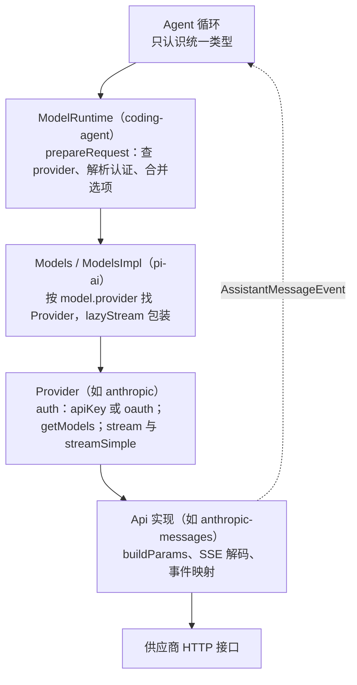

# 04. 模型与供应商

> 预计时间：2 小时（主线，不含选读）
> 先修：消息、事件与状态（`AssistantMessage`、`AssistantMessageEvent`，定义在 `packages/ai/src/types.ts`）

## 本篇你会学到

- 说出 `Api`、`Model`、`Provider`、`Models` 各自负责什么，并在 `packages/ai/src` 中找到它们。
- 解释 `stream` 与 `streamSimple` 的区别，沿 Anthropic 适配器追踪一次请求从发出到收到事件的全过程。
- 按"凭据解析、模型发现、实际请求"三个阶段排查认证问题，并用 faux provider（脚本化的假模型）写一个离线测试。

## 先用一个例子理解

用户在 pi 里输入"读取 demo.txt 并总结"。这句话要变成供应商的 HTTP 请求。pi 内部只有一种形状：系统提示、用户消息、工具定义。但不同供应商要的形状不同。

下面是同一句话经过两个适配器后，真实发出的请求体。取值方法：在 `streamSimple` 上传入假的 `fetch`（不联网，返回脚本化的 SSE 文本）和 `onPayload`（拿到适配器已经构造好的参数对象），运行一个临时脚本。脚本没有保存在仓库中。

Anthropic Messages。模型是 `claude-haiku-4-5`，取自内置目录，适配器是 `anthropic-messages`：

```json
{
  "model": "claude-haiku-4-5",
  "messages": [
    {
      "role": "user",
      "content": [
        {
          "type": "text",
          "text": "读取 demo.txt 并总结",
          "cache_control": { "type": "ephemeral" }
        }
      ]
    }
  ],
  "max_tokens": 64000,
  "stream": true,
  "system": [
    {
      "type": "text",
      "text": "你是编码助手",
      "cache_control": { "type": "ephemeral" }
    }
  ],
  "tools": [
    {
      "name": "read",
      "description": "读取文件",
      "eager_input_streaming": true,
      "input_schema": {
        "type": "object",
        "properties": { "path": { "type": "string" } },
        "required": ["path"]
      },
      "cache_control": { "type": "ephemeral" }
    }
  ],
  "thinking": { "type": "disabled" }
}
```

OpenAI Chat Completions。模型是目录中第一个 `api` 为 `openai-completions` 的模型，即供应商 `ant-ling` 的 `Ling-2.6-1T`，适配器是 `openai-completions`：

```json
{
  "model": "Ling-2.6-1T",
  "messages": [
    { "role": "system", "content": "你是编码助手" },
    { "role": "user", "content": "读取 demo.txt 并总结" }
  ],
  "stream": true,
  "stream_options": { "include_usage": true },
  "max_tokens": 65536,
  "tools": [
    {
      "type": "function",
      "function": {
        "name": "read",
        "description": "读取文件",
        "parameters": {
          "type": "object",
          "properties": { "path": { "type": "string" } },
          "required": ["path"]
        },
        "strict": false
      }
    }
  ]
}
```

两份请求体都来自同一个 `TranscriptContext`：系统提示、用户消息、工具定义只有一份。下面逐个字段说明 Anthropic 的一侧：

- `model`：目录项的 `id`，发给服务器决定用哪个模型。
- `messages`：只有一条用户消息。文本被包成数组，末尾块带 `cache_control`，告诉服务器把这段前缀放进缓存。
- `max_tokens`：本次输出上限。`buildParams` 取 `options?.maxTokens ?? model.maxTokens`，这里没有传 `maxTokens`，所以用 `model.maxTokens`（64000）。
- `stream: true`：要求服务器逐条返回事件。
- `system`：系统提示放在顶层数组里，不放在 `messages` 中。
- `tools`：每个工具一个对象。`input_schema` 是工具参数的 JSON Schema。
- `thinking`：本次关闭推理。模型的 `reasoning` 为 true，但 `streamSimple` 没有收到 `reasoning` 选项，所以 `thinkingEnabled` 为 false，`buildParams` 写入 `{ "type": "disabled" }`。

再看 OpenAI 一侧：

- `messages[0]`：系统提示，角色是 `system`。这里不是 `developer`，取决于 `model.reasoning` 与 `compat.supportsDeveloperRole` 是否同时满足（`convertMessages` 中的 `instructionRole`）。
- `stream_options.include_usage`：请求服务器在流的末尾附带 token 用量。
- `max_tokens`：输出上限。字段名由 `compat.maxTokensField` 决定，另一个可选名字是 `max_completion_tokens`。
- `tools[0].function.parameters`：参数的 JSON Schema，外面包了一层 `function`。
- `strict: false`：工具声明中的严格模式开关，本次为 false。

两家字段名不同，适配器做的是这张表的互相翻译。下表逐项对照：

| 差异点 | Anthropic Messages（`api/anthropic-messages.ts`，`buildParams`） | OpenAI Chat Completions（`api/openai-completions.ts`，`buildParams`） |
| --- | --- | --- |
| 系统提示 | 顶层 `system` 数组，每项是 `{ "type": "text", "text": ... }` | `messages` 中第一条 `role: "system"` 消息 |
| 用户消息 | `content` 是数组，末尾块带 `cache_control` | `content` 是普通字符串 |
| 输出上限 | `max_tokens`，默认取 `model.maxTokens`（实测 64000） | `max_tokens`（实测 65536）；字段名由 `compat.maxTokensField` 决定 |
| 工具声明 | 平铺：`name`、`description`、`input_schema` | 包一层：`type: "function"`，参数在 `function.parameters` |
| 推理开关 | `thinking: { type: "disabled" }`，`reasoning` 为 true 且本次未请求推理 | 本次请求没有 `thinking` 字段 |
| 流选项 | 没有额外字段 | `stream_options: { include_usage: true }` |
| 流事件的形状 | 每个事件有 `type` 字段，如 `message_start` | 每个 chunk 没有 `type` 字段（实测 `onProviderStreamEvent` 收到的 `type` 为 undefined），只有 `choices[0].delta` 片段 |
| 停止原因字段 | `message_delta` 里的 `stop_reason`（实测 `end_turn`） | `choices[0].finish_reason`（实测 `stop`） |

注意 `onPayload` 收到的是参数对象，SDK 再把它序列化成请求体。所以这里的字段名和值就是 SDK 发出的内容。

如果 Agent 循环直接写这些分支，每加一家供应商都要改循环代码。`packages/ai` 的做法是：Agent 只认识统一类型（`Model`、`Message`、`AssistantMessageEvent`）；每家供应商的差异留在适配器内部。适配器负责两件事：

- 请求方向：把 pi 的消息和工具转成供应商的请求体。
- 响应方向：把供应商的流式数据转成 pi 的统一事件，最后得到一条统一的 `AssistantMessage`。

本篇只回答"供应商怎样被隐藏在统一接口后面"。模型何时再次被请求、工具何时执行，属于下一篇。

## 核心概念

本篇有六个核心概念。每个都先给定义，再说为什么需要，最后给小例子。

### 1. Api：协议方言名

**定义**：`Api` 是一套接口协议的名字，例如 `"anthropic-messages"`、`"openai-completions"`、`"bedrock-converse-stream"`。

**为什么需要**：两个供应商可能共用同一套协议（例如很多服务都兼容 OpenAI 的 Chat Completions），也可能一家有多套协议。`Api` 让代码按"协议"选择实现，而不是按"供应商名"硬编码。

**定义位置**：`packages/ai/src/types.ts` 中的 `Api` 类型。

```typescript
export type Api = KnownApi | (string & {});
```

`KnownApi` 是内置的已知取值。`(string & {})` 让第三方也能注册自己的协议名，同时保留编辑器的自动补全。

### 2. Model：模型的静态描述

**定义**：`Model<TApi>` 描述一个具体模型：它的 `id`、属于哪个 `provider`、走哪个 `api`、上下文长度、单次输出上限、价格、能否推理等。它是数据，不包含任何请求逻辑。

**为什么需要**：路由（选哪个适配器）、截断判断（输出超过 `maxTokens` 会得到 `length`）、成本统计（用 `cost` 乘出费用）都要读模型元数据。

**定义位置**：`packages/ai/src/types.ts` 中的 `Model` 接口。`ImageModel` 与 `ClassifierModel` 是同一思路的另外两种模型类型。

`Model` 的字段定义在 `packages/ai/src/types.ts` 的 `BaseModel` 与 `Model` 中。下表列出全部字段。示例值来自内置目录的 `claude-haiku-4-5`（用 `getBuiltinProviders` 之外的 `anthropicProvider().getModels()` 读取并打印，见上文的实测脚本）。

| 字段 | 必填 | 含义 | 示例值（实测） |
| --- | --- | --- | --- |
| `id` | 是 | 模型 id，原样发给供应商 | `claude-haiku-4-5` |
| `name` | 是 | 显示名，只给人看 | `Claude Haiku 4.5 (latest)` |
| `api` | 是 | 协议名，决定走哪个适配器 | `anthropic-messages` |
| `provider` | 是 | 供应商 id，决定在 `Models` 中找哪个 `Provider` | `anthropic` |
| `baseUrl` | 是 | 默认 API 根地址 | `https://api.anthropic.com` |
| `input` | 是 | 接受的输入类型 | `["text", "image"]` |
| `reasoning` | 是 | 模型能否推理。注意：它只说明能力，不说明本次请求一定推理 | `true` |
| `cost` | 是 | 每百万 token 的价格（美元，见 `ModelCostRates` 注释） | `{"input":1,"output":5,"cacheRead":0.1,"cacheWrite":1.25}` |
| `contextWindow` | 是 | 上下文窗口，单位 token | `200000` |
| `maxTokens` | 是 | 单次输出的默认上限，单位 token | `64000` |
| `type` | 否 | 省略即为聊天模型；图片模型是 `"image"`，分类模型是 `"classifier"` | 本例键存在，值未打印 |
| `inputLimits` | 否 | 输入限制，如每条消息的图片数（`ModelInputLimits`） | 本例键存在，值未打印 |
| `promptCache` | 否 | 每个缓存级别的存活秒数（`ModelPromptCache`），未知时不写 | 本例键存在，值未打印 |
| `compat` | 否 | 协议兼容开关，内容随 `api` 变化，如 `forceAdaptiveThinking`、`supportsStrictTools` | 本例键存在，值未打印 |
| `thinkingLevelMap` | 否 | pi 的推理档位到供应商取值的映射；值为 `null` 表示该档位不支持 | 本例没有此键 |
| `headers` | 否 | 每次请求附加的固定 HTTP 头；值为 `null` 表示删除同名默认头 | 本例没有此键 |
| `samplingParams` | 否 | 默认附加的采样参数，按键覆盖（如 `top_p`） | 本例没有此键 |
| `samplingParamsByThinkingLevel` | 否 | 按推理档位选择的采样参数覆盖 | 本例没有此键 |

几个容易混淆的字段：

- `reasoning` 为 true 只是能力声明。本次请求是否推理，由 `streamSimple` 的 `reasoning` 选项决定。没有传 `reasoning` 时，Anthropic 适配器写入 `thinking: { type: "disabled" }`（见上文的请求体）。
- `maxTokens` 是默认上限。`buildParams` 先看 `options.maxTokens`，只有调用方没有给值时才使用 `model.maxTokens`。
- `cost` 只用于统计。`calculateCost`（`packages/ai/src/models.ts`）用 `cost` 乘上 `usage` 得到费用；它不影响请求内容。
- `api` 与 `provider` 不能互相推断。同一个 `api`（如 `openai-completions`）可以被很多供应商使用，同一个供应商也可以有多个 `api`。
- `compat` 只在需要时写。缺省时，适配器根据 `baseUrl` 与模型 id 推断兼容开关（OpenAI 兼容协议的做法见选读）。

这些字段在运行时的不同环节被读取：路由读 `provider` 与 `api`，费用统计读 `cost`，推理请求读 `reasoning` 与 `thinkingLevelMap`。`maxTokens` 作为请求的默认输出上限使用。输出是否被截断，由供应商返回的停止原因决定：Anthropic 的 `max_tokens` 映射为 pi 的 `length`（见 `mapStopReason`，`packages/ai/src/api/anthropic-messages.ts`）。

### 3. Provider：供应商 = 认证 + 目录 + 请求实现

**定义**：`Provider` 是一个供应商的完整能力：怎样认证（`auth`）、有哪些模型（`getModels`）、怎样发请求（`stream`、`streamSimple`）。

**为什么需要**：把"怎样登录""有什么模型""怎样发请求"放在同一个对象里，上层只需要给出 provider id 和 model id 就能工作。

**定义位置**：`packages/ai/src/models.ts` 中的 `Provider` 接口。下面是删减后的必需成员：

```typescript
export interface Provider<TApi extends Api = Api> {
  readonly id: string;
  readonly name: string;
  readonly auth: ProviderAuth;                 // 必填：apiKey 与 oauth 至少提供一种
  getModels(): readonly Model<TApi>[];         // 必填：同步返回当前聊天模型
  stream<T extends TApi>(model: Model<T>, context: TranscriptContext, options?: ApiStreamOptions<T>): AssistantMessageEventStream;
  streamSimple(model: Model<TApi>, context: TranscriptContext, options?: SimpleStreamOptions): AssistantMessageEventStream;
  // 可选：getAllModels、refreshModels、filterModels、fetchDeferred、cancelDeferred、generateImages、classify
}
```

两条规则要记住：

- `auth` 是必填的。源码注释要求：即使是本地无认证的服务器，也要提供一个 `apiKey` 形式的认证，它的 `resolve()` 报告"是否已配置"。`auth` 的类型 `ProviderAuth` 定义在 `packages/ai/src/auth/types.ts`。
- `stream` 与 `streamSimple` 都是必填成员（接口里没有 `?`）。

`packages/ai/src/providers/anthropic.ts` 的 `anthropicProvider()` 是一个完整例子：它返回 `createProvider({...})`，传入 `id: "anthropic"`、`auth: { apiKey, oauth }`、`models`，以及 `api: anthropicMessagesApi()`。

### 4. Models：运行时的集合与门面

**定义**：`Models` 是运行时的供应商集合。它负责按 id 查找供应商和模型、解析认证、把请求分派给拥有该模型的供应商。

**为什么需要**：调用方不想知道"这个模型归哪个供应商、认证怎么取"。它只调用 `Models` 的方法。

**定义位置**：`packages/ai/src/models.ts` 中的 `Models` 接口与 `MutableModels`（增加了 `setProvider` 等修改方法）；`createModels()` 返回可修改的实例。真正的实现类是未导出的 `ModelsImpl`。

`ModelsImpl.streamSimple` 的核心逻辑（删减）：

```typescript
streamSimple(model, context, options) {
  const transcript = normalizeContext(context);   // 先把 Context 规范化
  return lazyStream(model, async () => {          // 先返回流，异步准备放在 setup 里
    const provider = this.requireChatProvider(model);
    const { requestModel, requestOptions } = await this.applyAuth(model, options);
    return provider.streamSimple(requestModel, transcript, requestOptions);
  });
}
```

`normalizeContext` 定义在 `packages/ai/src/utils/transcript.ts`。它把调用方的 `Context`（可能带有 `systemPrompt` 之类的简写字段）折成 `TranscriptContext`：系统提示和工具声明都放进消息数组中。下游适配器因此只需处理一种形状。

### 5. stream 与 streamSimple：两条入口

**定义**：两者都是"发起一次模型请求，返回一个事件流"。区别在选项：

- `stream(model, context, options)`：选项类型 `ApiStreamOptions<T>` 随 `model.api` 变化，可以直接传协议特有的参数。
- `streamSimple(model, context, options)`：选项类型 `SimpleStreamOptions` 是供应商无关的通用选项，例如推理档位（`reasoning`）、工具选择（`toolChoice`）、延迟应答。适配器负责把它翻译成供应商的字段。

**为什么两者都需要**：Agent 循环只关心"通用档位"，用 `streamSimple` 就够。扩展或测试需要精确控制某家协议的参数时，用 `stream`。

**定义位置**：`packages/ai/src/compat.ts` 中的导出函数 `stream`（约在文件中部）与 `streamSimple`。`compat.ts` 还导出 `complete`、`completeSimple`（只返回最终消息的便捷版）、`registerApiProvider`、`registerFauxProvider`、`registerBuiltInApiProviders`。

适配器文件同时导出这两个函数。例如 `packages/ai/src/api/anthropic-messages.ts` 中有 `export const stream` 与 `export const streamSimple`，类型分别是 `StreamFunction<"anthropic-messages", AnthropicOptions>` 与 `StreamFunction<"anthropic-messages", SimpleStreamOptions>`。

**错误在哪里报告**：这是新手最容易误解的地方。`StreamFunction` 的注释明确说明：

- 直接调用适配器的 `streamSimple`，在缺少认证时可能同步抛出异常。
- 一旦返回了流，之后的请求错误都要编码进流：以 `error` 事件结束，最终消息的 `stopReason` 为 `"error"` 或 `"aborted"`。

所以调用方要么 `try/catch` 包住同步调用，要么统一从流的 `error` 事件读取。

### 6. AssistantMessageEventStream：增量事件与最终结果

**定义**：`AssistantMessageEventStream` 是一个可以 `for await` 读取的事件流，同时提供 `result()` 方法等待最终的 `AssistantMessage`。它的类定义在 `packages/ai/src/utils/event-stream.ts`，继承自通用的 `EventStream`。

**事件类型**（`packages/ai/src/types.ts` 中的 `AssistantMessageEvent` 联合类型，按 `type` 字段区分）：

| 类别 | 事件 `type` | 含义 |
| --- | --- | --- |
| 开始 | `start` | 响应开始，携带 `partial` |
| 文本 | `text_start`、`text_delta`、`text_end` | 文本块开始、增量、结束（`text_end` 带完整内容） |
| 推理 | `thinking_start`、`thinking_delta`、`thinking_end` | 同文本块的结构 |
| 工具调用 | `toolcall_start`、`toolcall_delta`、`toolcall_end` | `toolcall_end` 携带完整的 `toolCall` |
| 终态 | `done`、`error` | 成功或失败；携带完整的 `AssistantMessage` |

**为什么需要**：界面要实时显示增量；Agent 要知道最终消息以决定下一步。事件流同时满足两者。

**两条规则**：

- `done` 与 `error` 是终态。推入其中一个时，`result()` 的 Promise 才会完成。适配器必须发出其中一个终态事件，不能只结束迭代器。
- `error` 事件不会让 `result()` 被拒绝（reject）。它 resolve 为一条 `stopReason` 为 `"error"` 的 `AssistantMessage`。所以要检查 `stopReason`，而不是只依赖异常。

### 把六个概念连起来



读图要点：

- 箭头从上往下是"请求"，从下往上（虚线）是"事件"。
- `Provider` 节点内有三个必需的部分：认证、目录、两个流方法。
- 只有最底层的 `Api` 实现知道 Anthropic 的 SSE 长什么样。

## 源码导览

建议按下表顺序阅读。表中的符号都已在仓库中确认存在。

| 顺序 | 文件路径（相对仓库根） | 符号 | 读的时候关注什么 |
| --- | --- | --- | --- |
| 1 | `packages/ai/src/types.ts` | `Api`、`KnownApi`、`Model`、`StreamFunction`、`AssistantMessageEvent`、`StopReason` | 协议名、模型字段、事件联合类型、停止原因取值 |
| 2 | `packages/ai/src/models.ts` | `Provider`、`Models`、`MutableModels`、`createModels`、`createProvider` | `auth` 必填；`stream` 与 `streamSimple` 必填；按 `model.api` 分派 |
| 3 | `packages/ai/src/auth/types.ts` | `ProviderAuth`、`ApiKeyAuth` | `resolve()` 返回的 `source` 字段；`login()` 的交互方式 |
| 4 | `packages/ai/src/compat.ts` | `stream`、`streamSimple`、`complete`、`registerApiProvider`、`registerFauxProvider` | 两条入口的签名；faux 注册的是 api 级实现，不占用 provider id |
| 5 | `packages/ai/src/utils/transcript.ts` | `normalizeContext`、`resolveTranscript` | `Context` 如何折成规范化的 `TranscriptContext` |
| 6 | `packages/ai/src/providers/anthropic.ts` | `anthropicProvider`、`anthropicApiKeyAuth`（未导出） | 认证的四层优先级；`models` 与 `api` 的装配 |
| 7 | `packages/ai/src/providers/anthropic.models.ts` | `ANTHROPIC_MODELS` | 静态目录数据；目录是数据，不是逻辑 |
| 8 | `packages/ai/src/api/anthropic-messages.lazy.ts` | `anthropicMessagesApi` | 懒加载：真正用到时才加载适配器 |
| 9 | `packages/ai/src/api/lazy.ts` | `lazyApi`、`lazyStream` | 首次调用时加载实现；失败怎样传回调用方 |
| 10 | `packages/ai/src/api/anthropic-messages.ts` | `stream`、`streamSimple`、`buildParams`、`convertTools`、`iterateSseMessages`、`iterateAnthropicEvents`、`decodeSseLine`、`mapStopReason` | 请求转换、SSE 解码、事件映射、停止原因映射 |
| 11 | `packages/ai/src/utils/event-stream.ts` | `EventStream`、`AssistantMessageEventStream` | 终态条件；`result()` 如何完成 |
| 12 | `packages/ai/src/env-api-keys.ts` | `ANTHROPIC_AUTH_TOKEN_ENV`、`ANTHROPIC_OAUTH_TOKEN_ENV`、`AWS_BEARER_TOKEN_BEDROCK` | 认证使用的环境变量名常量 |
| 13 | `packages/coding-agent/src/core/model-runtime.ts` | `ModelRuntime`、`prepareRequest`、`getAuth`、`hasConfiguredAuth`、`getAvailableSnapshot` | 应用层如何为一次请求准备认证与选项 |
| 14 | `packages/coding-agent/src/core/provider-composer.ts` | `composeModelProvider`、`applyExtension` | 内置、`models.json`、扩展三种来源如何合成一个 provider |
| 15 | `packages/coding-agent/src/core/model-config.ts` | `ModelConfig`、`ModelConfig.load` | `models.json` 的读取与校验 |
| 16 | `packages/ai/src/all.ts`（实际为 `packages/ai/src/providers/all.ts`） | `getBuiltinProviders`、`getBuiltinModels`、`getBuiltinModel` | 内置供应商的集中入口 |
| 17 | `packages/ai/src/models.generated.ts` | `MODELS`、`IMAGE_MODELS`、`CLASSIFIER_MODELS` | 生成文件，不要手改 |
| 18 | `packages/ai/scripts/generate-models.ts` | （整个脚本） | 目录变更的真正入口 |
| 19 | `packages/ai/src/providers/faux.ts` | `fauxText`、`fauxThinking`、`fauxToolCall`、`fauxAssistantMessage`、`createFauxCore`、`fauxProvider` | 脚本化响应；`state.callCount` 的自增位置 |
| 20 | `packages/coding-agent/test/suite/harness.ts` | `createHarness`、`Harness` | 离线会话：真实结构的 `AgentSession`，模型换成 faux |

注意：第 16 项的文件实际路径是 `packages/ai/src/providers/all.ts`，表中已写出正确路径。

## 走读一次完整过程

下面以 Anthropic 为例，追踪一次普通文本请求（没有工具调用）。每步写出：发生了什么、对应的符号、状态有什么变化。

先看结果。下面的顺序是用 `streamSimple` 实测得到的：假的 `fetch` 返回一段脚本化的 SSE 文本，适配器照常解析。左列是 Anthropic SSE 的 `event:` 名，中列是 pi 发出的 `AssistantMessageEvent`。

| 序号 | Anthropic SSE 事件 | pi 事件 | `output.content` 的变化 |
| --- | --- | --- | --- |
| 1 | `message_start` | `start` | 仍是空数组 |
| 2 | `ping` | 无（适配器跳过，`onProviderStreamEvent` 收不到） | 无 |
| 3 | `content_block_start`（`type: "text"`） | `text_start`，`contentIndex=0` | 出现一个文本块，`text` 为空 |
| 4 | `content_block_delta`（`text_delta`，"文件内容"） | `text_delta`，`delta="文件内容"` | 文本变为 "文件内容" |
| 5 | `content_block_delta`（`text_delta`，"摘要"） | `text_delta`，`delta="摘要"` | 文本变为 "文件内容摘要" |
| 6 | `content_block_stop` | `text_end`，`content` 为完整文本 | 不变；临时字段 `index` 被删除 |
| 7 | `message_delta`（`stop_reason: "end_turn"`） | 无 | `stopReason` 变为 `stop`，`rawStopReason` 为 `end_turn` |
| 8 | `message_stop` | 无（只用于检查流是否完整） | 不变 |
| 9 | 流结束 | `done`，`reason=stop` | 最终消息 |

几点说明：

- `start` 在 HTTP 响应到达后、解析第一个 SSE 事件之前推出，那时内容还是空的。随后的 `message_start` 更新 `responseId` 与初始用量。
- 第 2 步的 `ping` 在 `iterateAnthropicEvents` 中被过滤，因为它不在 `ANTHROPIC_MESSAGE_EVENTS` 集合中。
- 第 6 步的 `text_end` 才携带完整文本。界面可以在增量中逐字显示；Agent 则应以 `done` 中的完整消息为准。
- 第 7、8 步没有对应的 pi 事件。停止原因写进了 `output`，`done` 在流结束后统一发出。
- 运行输出里 `RAW`（上游事件）与 `EVENT`（pi 事件）的行会交错出现，因为适配器把事件推入队列，消费端稍后才读取。判断顺序时只看 `EVENT` 行。

工具调用版本的差别只在中间几步：`content_block_start`（`type: "tool_use"`）产生 `toolcall_start`；两个 `input_json_delta`（分别是 `{"path":` 与 `"demo.txt"}`）各产生一个 `toolcall_delta`；`content_block_stop` 产生 `toolcall_end`，它携带解析后的 `arguments: {"path":"demo.txt"}`；`message_delta` 的 `stop_reason` 为 `tool_use`，映射为 `stopReason: "toolUse"`；最后是 `done`，`reason` 也是 `toolUse`。

下面第 6 步有一处需要补充：`streamSimple` 本身只做同步的认证检查，然后调用 `stream`；真正创建 `AssistantMessageEventStream` 的是 `stream`。两者都同步返回流，异步工作在后台进行。

### 装配：供应商对象在启动时就准备好了

1. **读取供应商定义。** `anthropicProvider()`（`packages/ai/src/providers/anthropic.ts`）返回一个 `Provider`。它的 `name` 是 `"Anthropic"`，`baseUrl` 是 `https://api.anthropic.com`，`models` 来自 `ANTHROPIC_MODELS`。
2. **挂上懒加载的实现。** `api: anthropicMessagesApi()` 返回的是 `lazyApi(...)` 包装，此时还没有加载 Anthropic 的 SDK 和适配器代码。`lazyApi` 在首次调用 `stream` 或 `streamSimple` 时才动态加载真正的模块。这样 CLI 启动时不必加载几十个供应商 SDK。
3. **装入 `Models`。** `createModels()` 或 `ModelRuntime` 把 `Provider` 注册进去（`setProvider`）。此后 `getModel("anthropic", id)` 能找到模型。

### 一次请求：从 ModelRuntime 到 Anthropic 适配器

4. **应用层准备（coding-agent）。** 调用方通过 `ModelRuntime` 的流式方法发起请求。`prepareRequest`（`packages/coding-agent/src/core/model-runtime.ts`）做四件事：
   - 按 `model.provider` 找到 `Provider`；找不到就报错。
   - 调用 `getAuth(model, overrides)` 解析认证；未配置时报错。
   - 把认证结果中的 headers 与 env 与调用方传入的选项合并。
   - 得到"已带凭据形状"的 `model` 与 `options`，交给 provider 的 `streamSimple`。
5. **分派（pi-ai）。** `ModelsImpl.streamSimple`（`packages/ai/src/models.ts`）先调用 `normalizeContext`，再用 `lazyStream` 立即返回一个外层流。异步的 setup 函数里依次执行：`requireChatProvider` 查找供应商，`applyAuth` 解析认证，然后调用 `provider.streamSimple(...)`。`lazyStream` 的好处：setup 中的异步错误会变成外层流的 `error` 事件，而不是调用点的异常。
6. **进入适配器。** `anthropicMessagesApi()` 此时才加载 `packages/ai/src/api/anthropic-messages.ts`。`streamSimple` 是该文件导出的函数。它创建一个 `AssistantMessageEventStream`，然后在后台异步工作。流对象本身同步返回。
7. **构造请求体。** `buildParams` 生成 Anthropic 的请求参数。关键字段：`max_tokens: options?.maxTokens ?? model.maxTokens` 与 `stream: true`。工具通过 `convertTools` 转换，其中 `input_schema` 是 Anthropic 的工具参数字段。
8. **发送请求。** 适配器创建 SDK 客户端并设置 `maxRetries: 0`（SDK 不自动重试）。真正的请求调用是 `client.beta.messages.create(params, requestOptions).asResponse()`，外面包了 `retryProviderRequest`。重试由 pi 统一处理，避免 SDK 重试与 pi 重试叠加。
9. **解码 SSE。** 响应体是服务器逐条推送的文本协议（SSE）。`iterateSseMessages` 把字节切成 SSE 帧（`event:` 与 `data:` 行，空行结束一帧）。`decodeSseLine` 解析单行。`iterateAnthropicEvents` 只保留 Anthropic 的消息事件（`ANTHROPIC_MESSAGE_EVENTS` 集合）并把 `data` 解析为 JSON。
10. **映射为统一事件。** 适配器按事件类型分派：
    - `message_start`：记下响应 id、实际模型、输入 token 等初值。
    - `content_block_start`：创建对应的文本、推理或工具调用块，发出 `*_start`。
    - `content_block_delta`：把增量追加到块上，发出 `*_delta`。
    - `content_block_stop`：发出 `*_end`，清理临时字段。
    - `message_delta`：更新停止原因与用量。
11. **停止原因映射。** `mapStopReason` 把 Anthropic 的停止原因转为 pi 的 `StopReason`。例如 `end_turn` 变为 `stop`；`refusal` 变为 `error`；`pause_turn` 变为 `stop`（源码注释："Stop is good enough -> resubmit"）。
12. **终态。** 成功时推入 `done`（携带完整 `AssistantMessage`）；异常时推入 `error`（`stopReason` 为 `"error"` 或 `"aborted"`，错误文本在 `errorMessage`）。推入终态后，`result()` 完成。
13. **回到调用方。** Agent 或界面按事件消费；Agent 最终读取终态消息的 `stopReason` 决定下一步（下一篇讲）。

状态变化小结：`AssistantMessage` 的 `content` 从空数组开始，随 `start`、`*_delta` 逐步增长；块内的临时字段（供应商的块下标、未完成的工具 JSON）在块结束或出错时删除，最终消息中不应出现。

### 为什么不能用单个 delta 执行工具

工具调用的 JSON 参数是分片到达的。例如第一个增量是 `{"path":`，第二个才是 `"demo.txt"}`。前者不是合法 JSON，不能执行。适配器只在 `toolcall_end` 时给出完整的 `toolCall`；但 `toolcall_end` 只表示"模型输出了完整的工具调用"，不表示工具已经执行。真正的执行发生在 Agent 循环里。

## 认证解析的三个阶段

认证容易出问题，因为它分三个时间点发生，每个时间点回答不同的问题：

```text
阶段 1：凭据解析     resolve()        这台机器上有没有可用的凭据？来自哪里？
阶段 2：模型发现     getModels() 等   这个凭据能看到哪些模型？
阶段 3：实际请求     prepareRequest   把凭据放进这一次请求的 headers / env 中
```

三个阶段不能互相替代：

- "配置了认证" 不等于 "认证有效"。OAuth 可能已过期，账号可能已降级。
- "列表里有某个模型" 不等于 "供应商允许你调用它"。`filterModels` 只按本地凭据做过滤。
- "请求发出去了" 不等于 "模型真的回答了"。

### 阶段 1：凭据解析（resolve）

Anthropic 的 `anthropicApiKeyAuth()`（未导出，位于 `packages/ai/src/providers/anthropic.ts`）按下面的顺序解析。顺序就是优先级，靠前的优先：

1. **已保存的凭据。** 如果 `credential?.key` 存在，返回 `{ auth: { apiKey }, source: "stored credential" }`。
2. **`ANTHROPIC_AUTH_TOKEN` 环境变量。** 如果存在，作为 `Authorization: Bearer ...` 头发送，`source` 为该变量名。
3. **`ANTHROPIC_OAUTH_TOKEN` 或 `ANTHROPIC_API_KEY`。** 依次检查，第一个非空的生效，`source` 为该变量名。
4. **工作负载身份联合（workload identity federation）。** 需要三个环境变量同时提供：规则 id、组织 id、身份令牌文件路径（常量名为 `ANTHROPIC_FEDERATION_RULE_ID_ENV`、`ANTHROPIC_ORGANIZATION_ID_ENV`、`ANTHROPIC_IDENTITY_TOKEN_FILE_ENV`）。`source` 为 `"workload identity federation"`。

`resolve` 在开头调用一次 `signal.throwIfAborted()`，并在每次读取环境变量（`ctx.env(...)`）之后再调用一次。`signal` 是 `AbortSignal`（取消信号）：调用方取消请求后，`throwIfAborted()` 会抛出异常，解析在下一个检查点停止，不再读取后面的变量。

**认证的三个阶段在时间线上的位置。** 用同一个 Anthropic 例子说明：

- 阶段 1（凭据解析）：`resolve` 按上面的顺序找第一个可用的凭据，返回 `auth`、`source` 等字段。
- 阶段 2（模型发现）：`getModels()` 返回静态目录，它不依赖凭据。`hasConfiguredAuth` 只读后台快照，不访问网络。
- 阶段 3（实际请求）：`prepareRequest`（`packages/coding-agent/src/core/model-runtime.ts`）在每次请求时重新调用 `getAuth(model, { apiKey, env, signal })`，把结果的 headers 与 env 合并进请求选项，然后调用 `provider.streamSimple`。

**优先级实测。** 下面三组结果来自同一个临时脚本：每次只改变环境变量或已保存的凭据，然后创建新的 `createModels()` 并调用 `getAuth("anthropic")`。值都是测试值，没有联网。

| 进程环境变量 | 已保存凭据 | `source` | `auth` 的内容 |
| --- | --- | --- | --- |
| `ANTHROPIC_API_KEY=env-api-key` | 无 | `ANTHROPIC_API_KEY` | `{"apiKey":"env-api-key"}` |
| 同上，再加 `ANTHROPIC_AUTH_TOKEN=env-auth-token` | 无 | `ANTHROPIC_AUTH_TOKEN` | `{"headers":{"Authorization":"Bearer env-auth-token"}}` |
| 同上 | `api_key`，值为 `stored-api-key` | `stored credential` | `{"apiKey":"stored-api-key"}` |

读法：

- 第一行只有 `ANTHROPIC_API_KEY`，它生效。
- 第二行加入 `ANTHROPIC_AUTH_TOKEN` 后，它胜过 `ANTHROPIC_API_KEY`。原因是 `resolve` 先检查 `ANTHROPIC_AUTH_TOKEN`，并把它放进 `Authorization: Bearer` 头，而不是 `apiKey`。
- 第三行加入已保存的凭据后，`source` 变为 `stored credential`。已保存凭据的检查排在最前面，命中时直接返回，环境变量不再被读取。

所以排查时，先看 `source`，再决定改哪里。如果 `source` 是 `stored credential`，改环境变量没有效果，需要更新或删除已保存的凭据。

**读 `source` 字段排障。** 如果你设置了 `ANTHROPIC_API_KEY`，却发现请求使用的是另一个密钥，先看 `getAuth` 的结果里 `source` 是什么。通常是因为已保存的凭据优先级更高。

### 阶段 2：模型发现

`Provider.getModels()` 同步返回当前已知的聊天模型；`getAllModels()` 返回所有类型（包括图片、分类模型）。对于带凭据过滤的供应商，`filterModels(models, credential)` 可以按凭据隐藏模型。

`ModelRuntime`（coding-agent）提供同步的快照读取：

- `hasConfiguredAuth(providerId)`：只看本地快照，不访问网络，不执行命令。
- `getAvailableSnapshot()`：返回快照中可用的模型列表。

这两个方法是同步的，因此启动时可以频繁调用。它们读的是后台刷新的结果，所以可能暂时落后于最新的凭据变化。

### 阶段 3：实际请求

`prepareRequest` 在每次请求时调用 `getAuth(model, overrides)`。调用方传入的 `apiKey`、`env`、`signal` 作为覆盖值。得到的 headers 与 env 与调用方的选项合并后，才交给供应商。

这里有两个边界：

- 虚拟模型（coding-agent 中按请求路由的模型）路由到另一个供应商时，调用方传入的凭据不会被带过去，目标供应商自己解析认证。这样密钥不会发给错误的供应商。本篇不展开虚拟模型，选读中有一个注明的入口。
- 底层适配器的 `streamSimple` 不做阶段 1 与阶段 3 的合并。直接调用它时，缺少密钥可能同步抛出。

## 静态目录与动态目录

模型目录有两种形态。不要假设"模型列表是常量"。

### 静态目录

大多数内置供应商的模型是静态的：

- 数据来源是 `packages/ai/src/models.generated.ts`。该文件导出 `MODELS`、`IMAGE_MODELS`、`CLASSIFIER_MODELS`，约 300 行，由脚本生成。
- 每家供应商的子集在 `*.models.ts` 中，例如 `packages/ai/src/providers/anthropic.models.ts` 的 `ANTHROPIC_MODELS`。
- 内置供应商的集中入口在 `packages/ai/src/providers/all.ts`（`getBuiltinProviders`、`getBuiltinModels`、`getBuiltinModel`）。

**修改目录的规则**（来自仓库 `AGENTS.md`）：不要直接改 `models.generated.ts`。修改 `packages/ai/scripts/generate-models.ts` 的输入，然后重新生成。

### 动态目录

`Provider.refreshModels?(context)` 是可选方法。动态供应商（如网关类服务）用当前凭据向服务器拉取模型列表。`RefreshModelsContext` 提供"上次保存的结果"与"发布新结果"的入口。具体字段以 `packages/ai/src/models.ts` 为准。

`ModelsImpl` 合并静态与动态两部分的规则（`createProvider` 中的 `currentModels`）：

- 对每个动态模型，按 `(type, id)` 查找静态列表中的同名条目。
- 找到则替换；找不到则追加。

例子：静态列表有 `sonnet` 和 `haiku`；动态刷新返回 `sonnet`（新的上下文长度）和 `local-test`。合并结果是三个模型：`sonnet` 用动态版本，`haiku` 保持静态版本，`local-test` 是新增的。

### coding-agent 的第三层：`models.json`

coding-agent 在 pi-ai 之上还有一层应用配置，主要有三个来源：

1. **内置目录**：`packages/coding-agent/src/core/model-runtime.ts` 用命名空间导入 `import * as builtinProviderCatalog from "@earendil-works/pi-ai/providers/all"`。这指向 pi-ai 的 `packages/ai/src/providers/all.ts`，它提供 `getBuiltinProviders`、`getBuiltinModels`、`getBuiltinModelDataGeneratedAt` 等函数。`builtinProviderCatalog` 只是导入时起的名字，不是 pi-ai 导出的符号。
2. **`models.json`**：默认路径是 `join(getAgentDir(), "models.json")`（见 `agent-session-services.ts` 与 `model-runtime.ts`），由 `ModelConfig.load` 读取并校验。它可以覆盖 `baseUrl`，也可以新增自定义模型（如本地 OpenAI 兼容服务器）。
3. **扩展**：扩展注册的供应商。

`composeModelProvider`（`packages/coding-agent/src/core/provider-composer.ts`）把这些来源按固定顺序合成为一个最终的 `Provider`：

- 先取内置的基础模型；
- 再应用 `models.json` 中的自定义模型；
- 再应用扩展：`applyExtension`（未导出）的规则是，扩展提供了 `models` 时，结果只剩扩展声明的那些模型；只提供 `baseUrl` 时，保留全部模型，只把每个模型的 `baseUrl` 改为扩展的值；
- 最后应用 `models.json` 的 `modelOverrides`。源码注释称它为"最外层的用户配置"，因为它在前面所有层之后只应用一次。

这个顺序的一个后果：扩展的 `models` 会替换前面各层的全部模型，包括 `models.json` 中的自定义模型。想保留其它模型，扩展的 `models` 必须把它们也列出来；只想改 URL 时，只提供 `baseUrl` 即可。

刷新结果的持久化路径：有 `modelsPath` 时，动态目录的结果保存到同目录下的 `models-store.json`（由 `ModelRuntime.create` 设置）。

## faux provider 离线测试

真实模型调用有费用、不稳定，还需要密钥。faux provider 是 pi 自带的假模型：它与真实供应商走同样的事件协议，但响应内容由脚本决定。

### 脚本怎样工作

在 `packages/ai/src/providers/faux.ts` 中：

- 辅助构造器：`fauxText`、`fauxThinking`、`fauxToolCall(name, args, { id? })`、`fauxAssistantMessage(content, { stopReason?, errorMessage?, ... })`。
- 每次模型请求消费队列中的一项，并让 `state.callCount` 加一。队列为空时抛出错误 `"No more faux responses queued"`。
- 队列控制：`setResponses`、`appendResponses`、`getPendingResponseCount`。

因此："一次 prompt 产生两次模型请求" 可以用两条脚本验证：第一条是工具调用，第二条是最终回答。`callCount` 为 2，`getPendingResponseCount()` 为 0。

### 在测试中使用

coding-agent 的测试套件把 faux 包装好了：`packages/coding-agent/test/suite/harness.ts` 的 `createHarness` 创建一个真实结构的 `AgentSession`，模型换成 faux，会话换成内存存储。注意 `createHarness` 是异步函数，必须 `await`。

```typescript
const h = await createHarness();
try {
  h.setResponses([
    fauxAssistantMessage([fauxToolCall("read", { path: "demo.txt" })], { stopReason: "toolUse" }),
    fauxAssistantMessage("总结完成"),
  ]);
  await h.session.prompt("读取 demo.txt 并总结");
  expect(h.faux.state.callCount).toBe(2);
} finally {
  h.cleanup();
}
```

这段代码的要点：

- `Harness` 上有 `session`（`AgentSession`）、`faux`（`FauxProviderRegistration`）、`setResponses`、`cleanup()`。
- `fauxAssistantMessage` 与 `fauxToolCall` 来自 faux 模块；导入路径以同目录中现有测试文件的写法为准（例如 `packages/coding-agent/test/suite/agent-session-boundaries.test.ts`）。
- `finally` 中调用 `cleanup()`，避免测试之间互相影响。

### 离线测试能证明什么

- 能证明：pi 对给定脚本的处理（事件顺序、消息内容、请求次数）。
- 不能证明：真实供应商的权限、模型可用性、服务端的实际行为。

## 动手实验

以下实验只使用本地测试和源码阅读，不调用真实 API，不需要密钥。实验不创建临时文件。

预期输出是在本地运行得到的结果。时间与路径可能不同，关键行一致即可。

### 实验 1：运行 Anthropic 的 SSE 解析测试（5 分钟）

目的：确认 Anthropic 适配器的 SSE 解码测试在本机通过。

PowerShell：

```powershell
Set-Location D:\Github\pi\packages\ai
node ..\..\node_modules\vitest\dist\cli.js --run test/anthropic-sse-parsing.test.ts
```

bash（Git Bash）：

```bash
cd /d/Github/pi/packages/ai
node ../../node_modules/vitest/dist/cli.js --run test/anthropic-sse-parsing.test.ts
```

预期输出的关键行：

```text
Test Files  1 passed (1)
Tests  14 passed (14)
```

### 实验 2：运行 faux provider 自身的测试

目的：确认脚本化假模型的行为符合测试断言。

PowerShell 与 bash 的命令相同，只是 `cd` 不同（同实验 1）。在 `packages/ai` 目录执行：

```text
node ../../node_modules/vitest/dist/cli.js --run test/faux-provider.test.ts
```

预期输出的关键行：`Tests  23 passed (23)`。

### 实验 3：用 harness 观察两次模型请求

目的：确认"工具调用 + 最终回答"需要两次模型请求，并看到 `callCount` 的断言。

在 `packages/coding-agent` 目录执行：

```text
node ../../node_modules/vitest/dist/cli.js --run test/suite/agent-session-boundaries.test.ts
```

预期输出的关键行：`Tests  29 passed (29)`。

阅读其中的断言，例如 `expect(harness.faux.state.callCount).toBe(2)`，它们说明：

- 不同场景的请求次数由脚本决定，而不是由 `prompt` 的次数决定。
- 同一次 `prompt` 可能产生多次模型请求。

### 实验 4：只读查找 `callCount` 的自增位置

目的：找到 faux 中计数的真实位置。

PowerShell：

```powershell
Select-String -Path packages\ai\src\providers\faux.ts -Pattern callCount
```

bash：

```bash
grep -n callCount packages/ai/src/providers/faux.ts
```

预期输出为 3 行：接口字段定义、初始化为 0、每次请求时执行 `state.callCount++`。行号可能不同。

## 自测题

1. 为什么 `Provider` 接口要求 `auth` 字段，即使是本地无认证的服务器？
2. `stream` 与 `streamSimple` 的选项有什么区别？为什么 `Provider` 接口中两者都是必填成员？
3. 环境变量 `ANTHROPIC_API_KEY` 已设置，同时还存在一条已保存的凭据。哪个生效？你从哪个字段判断？
4. faux 脚本只有两条响应。Agent 只请求了一次模型。`state.callCount` 与 `getPendingResponseCount()` 分别是多少？
5. 脚本已耗尽，又发生了一次模型请求。faux 会报告什么错误文本？

### 参考答案

1. 认证是 `Provider` 的一等成员。没有它，`Models.getAuth()` 无法判断供应商是否已配置，`hasConfiguredAuth` 也无从计算。本地服务器也要提供一个 `apiKey` 认证，其 `resolve()` 报告"是否已配置"。
2. `stream` 的选项随协议变化（`ApiStreamOptions<T>`），可以传协议特有参数；`streamSimple` 的选项（`SimpleStreamOptions`）是通用的，由适配器翻译。两者都是必填，因为上层 Agent 只需要通用档位，而扩展或测试可能需要协议级控制；接口没有 `?`，所以两个方法都必须实现。
3. 已保存的凭据生效。在 `anthropicApiKeyAuth` 的解析顺序中，已保存凭据排在环境变量之前。从 `getAuth` 的结果里的 `source` 字段判断：值为 `"stored credential"`。
4. `callCount` 为 1，`getPendingResponseCount()` 为 1。每次请求消费一条脚本，剩下的一条没有被使用。
5. 报告 `No more faux responses queued`。该错误来自 `packages/ai/src/providers/faux.ts`。

## 常见错误

| 现象 | 原因 | 解决 |
| --- | --- | --- |
| `getModel()` 返回 `undefined` | 目录里没有该 id，或拼写、大小写不对；或动态目录尚未刷新 | 用 `getModels(provider)` 核对；动态供应商先调用 `models.refresh()`（它会调用各供应商的 `refreshModels`） |
| 认证"配置了但不生效" | 优先级不符合预期：已保存凭据或更靠前的环境变量生效 | 查看 `getAuth` 结果中的 `source` 字段，按解析顺序逐层检查 |
| 自定义服务器返回 400 | 兼容开关与服务器不匹配，例如输出长度字段名 | 在 `Model.compat` 或 `models.json` 中设置对应开关，如 `maxTokensField`、`requiresToolResultName` |
| 以为 `streamSimple` 永不抛错 | 直接调用适配器时，缺少认证会同步抛出 | 用 `try/catch` 包住调用，或统一从流的 `error` 事件读取 |
| 测试中把 `prompt` 次数当成模型请求次数 | 一次 `prompt` 可能因工具调用产生多次模型请求 | 用 faux 的 `state.callCount` 断言请求次数 |

## 选读：源码深入

> 选读，跳过不影响主线。本节内容超出 Anthropic 主线，主要用于对照其他协议和理解 pi-ai 的边界。

### A. OpenAI Responses 与 Chat Completions 的对照

这两个适配器都会把 SDK 或 HTTP 的流式数据转为统一事件，但内部结构不同。

**OpenAI Responses**（`packages/ai/src/api/openai-responses.ts` 与 `openai-responses-shared.ts`）：

- 事件带有 `output_index`。`openai-responses-shared.ts` 用 `createSlot` 与 `getSlot` 维护 `output_index` 到 pi 内容块的对应关系。`getSlot` 会检查槽位类型，类型不符时忽略，而不是把增量写进错误的块。
- 下面这条未在本地验证：`response.output_item.done`、`response.completed`、`response.incomplete` 这些事件名，以及"只有整个响应结束才算请求完成"的说法。需要读 `processResponsesStream` 的事件分支后再确认。
- `processResponsesStream` 是导出的共享处理器（已核对）。`buildParams` 写入 `store: false` 的说法未在本地验证。

**OpenAI Chat Completions**（`packages/ai/src/api/openai-completions.ts`）：

- 以 `choices[0]` 为单个候选。源码只读取 `chunk.choices[0]`，不合并多个候选（已核对）。
- 结束原因来自 `finish_reason`。流结束时如果没有 `finish_reason`：兼容开关 `supportsFinishReason` 为 true 时抛出 `"Stream ended without finish_reason"`；为 false 时，pi 按内容推断为 `toolUse`（有工具调用块）或 `stop`。类型注释写明该开关默认为 true（已核对）。
- 兼容差异由 `OpenAICompletionsCompat` 管理（`packages/ai/src/types.ts`），包括 `supportsFinishReason`、`maxTokensField`、`requiresToolResultName`、`requiresAssistantAfterToolResult`、`supportsDeveloperRole`。同一个 `openai-completions` 协议，不同服务器需要不同开关。
- `convertMessages` 是导出函数，负责把 pi 的历史转为 Chat Completions 的消息数组。

### Amazon Bedrock

- 认证的环境变量检查在 `packages/ai/src/env-api-keys.ts` 的 `getEnvApiKey` 中。`AWS_PROFILE`、`AWS_ACCESS_KEY_ID` 加 `AWS_SECRET_ACCESS_KEY`、`AWS_BEARER_TOKEN_BEDROCK` 等任一条件成立，就返回 `<authenticated>`。`AWS_BEARER_TOKEN_BEDROCK` 没有单独的常量，变量名直接写在函数中。
- Bedrock 的 system 提示放在请求的单独字段 `system` 中（由 `buildSystemPrompt` 生成）。Bedrock 不支持对话中间的 system 消息，因此 `packages/ai/src/api/bedrock-converse-stream.ts` 先调用 `collapseSystemMessages(context)`，把所有 system 消息折叠进开头的系统提示。源码注释写的是："Bedrock has no mid-conversation system messages; fold them into the leading prompt."
- 以上只核对了源码位置，没有运行 Bedrock 请求。

### 未在本地验证的静态推断

以下内容是通过阅读 `iterateSseMessages` 的控制流推断的，没有写测试证明，也没有运行：

- 如果一个网络分块以 `\r` 结束，下一个分块以 `\n` 开始，解析器可能把两者当作两个行结束符，从而产生一个多余的空行，使事件的 `event` 名丢失。
- SSE 协议允许 CRLF，但跨分块的 CRLF 是否被正确处理，需要一个固定字节分块的测试来证明。

如果要修改解析器，应先写这样的确定性测试，再改实现。不要用 `sleep` 模拟网络分块。

## 下一篇

下一篇解决的问题：适配器已经把模型回答变成了统一的 `AssistantMessage`。Agent 怎样根据 `stopReason` 决定是执行工具、再次请求模型，还是结束这一轮。

## 术语小结

| 术语 | 一句话定义 | 首次出现的小节 |
| --- | --- | --- |
| Api | 一套接口协议的名字，如 `anthropic-messages` | 核心概念 1 |
| Model | 一个具体模型的静态描述，包含上下文长度、价格等 | 核心概念 2 |
| Provider | 一个供应商的认证、模型目录与请求实现的组合 | 核心概念 3 |
| auth | 供应商的认证方式集合，至少含 apiKey 或 oauth | 核心概念 3 |
| Models | 运行时的供应商集合与分派门面 | 核心概念 4 |
| normalizeContext | 把调用方的 Context 折成规范化的 TranscriptContext | 核心概念 4 |
| stream | 完整控制的请求入口，选项随协议变化 | 核心概念 5 |
| streamSimple | 通用选项的请求入口，由适配器翻译 | 核心概念 5 |
| AssistantMessageEventStream | 可逐个读取增量事件，并能等待最终消息的事件流 | 核心概念 6 |
| SSE | 服务器逐条推送文本事件的协议，以空行分隔事件 | 走读一次完整过程 |
| 凭据解析（resolve） | 从已保存凭据、环境变量等来源找到可用凭据 | 认证解析的三个阶段 |
| 静态目录 | 随代码生成的模型列表，如 `MODELS` | 静态目录与动态目录 |
| 动态目录 | 由 `refreshModels` 在运行时拉取的模型列表 | 静态目录与动态目录 |
| 懒加载（lazy） | 首次使用时才加载适配器代码 | 走读一次完整过程 |
| faux provider | 脚本化的假模型，用于离线测试 | faux provider 离线测试 |
